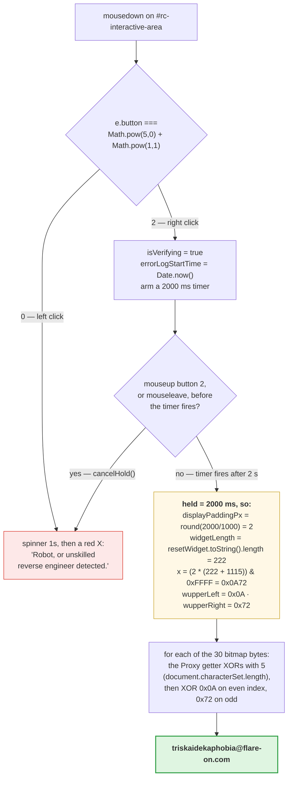

**Archive:** `1-flarecaptcha.7z` (password `flare`) · **Flag:** `triskaidekaphobia@flare-on.com`

Flare-On is a yearly reverse-engineering contest: you take programs apart to work
out what they really do, and each challenge hides a *flag*, a string ending in
`@flare-on.com`, that unlocks the next one. (Contests built this way are called
CTFs, for "capture the flag.")

Flare-On always opens with something gentle. This year it's a single HTML file (a
web page) pretending to be a reCAPTCHA box, Google's "I'm not a robot" checkbox.

There's one real trick in it. Finding it is easy; the annoying part is that every
comment near the trick is lying to you about what the code does. (Comments are notes
for human readers that the browser ignores, so they can say anything.) The source is
plain text, HTML for the layout and JavaScript for the behavior, so nothing needs
decompiling; the work is deciding which parts to believe.

## Tools I used

Honestly, not many. This one is a web challenge and the web tools are good enough
(DevTools is the inspector built into Chrome):

| Tool | What I used it for |
|---|---|
| `7z` | unpacking the archive |
| `python3 -m http.server` | serving the file from `localhost` instead of `file://`, so the page behaves normally |
| Chrome DevTools (Sources + Console) | reading the script, then driving the widget from the console |
| `python3` | re-implementing the flag derivation to check my reading of it |

No disassembler, no debugger, no emulation (the tools for reading compiled code,
pausing it mid-run, and running it on a simulated CPU). That comes later in the
series.

## What's in the box

```console
$ 7z x -pflare 1-flarecaptcha.7z
$ ls -l flarecaptcha
total 32
-rw-r--r--  1 user   staff  16048 Oct  1 09:23 flarecaptcha.html
```

One file, 16 KB, no JavaScript dependencies, and the only thing it fetches is a
Google Fonts stylesheet. Which means the
flag is in there, and the only question is what makes the page cough it up.


The markup (the HTML that draws the widget) is a loving reproduction of the real
reCAPTCHA v2 anchor, right down to a hand-drawn SVG of the circular-arrows logo and
dead `Privacy - Terms` links. The author clearly enjoyed this part.

My first move was the obvious one: click the checkbox. It spins for a second,
then gives me a red X and this:

> Robot, or unskilled reverse engineer detected.

Fair. Time to read the script.

## Reading the script

All the logic lives in one `DOMContentLoaded` handler, which runs once the page has
loaded. Skipping the DOM bookkeeping (the DOM is the browser's live model of the
page), the interesting part is the `mousedown` listener, a function the browser
calls the moment a mouse button goes down:

```js
interactiveArea.addEventListener('mousedown', (e) => {
    if (isVerified || isFailed || isVerifying) return;

    // Ensure click occured in captcha box with 5,0 and 1,1 layout grids
    if (e.button === (Math.pow(5, 0) + Math.pow(1, 1))) {
        ...
    }
    else if (e.button === 0) {
        // Spin briefly (1s) then fail test with red X
        ...
    }
});
```

That comment about "5,0 and 1,1 layout grids" is the first lie. There is no
grid. `Math.pow(5,0)` (5 to the power 0) is 1, `Math.pow(1,1)` is 1, and `1 + 1` is
**2**. `MouseEvent.button` is 0 for left, 1 for middle, 2 for right, so this is
`e.button === 2`, the **right** mouse button. Written plainly it would have been
spotted in a second, so it is dressed up as geometry instead. The
`e.button === 0` branch is the left click I tried first, and all it does is fail.

The right-click branch then does this:

```js
isVerifying = true;
errorLogStartTime = Date.now();
checkbox.className = 'rc-anchor-checkbox verifying';
checkbox.innerHTML = '<div class="rc-spinner"></div>';

// Requirement: Only detect as human if left click occurred more than X time after page load
rightClickHoldTimer = setTimeout(() => { ... }, 2000);
```

It records the time of the press (`Date.now()`, in milliseconds) and arms a timer
(`setTimeout`) to run a callback 2000 ms later.

And that is lie number two, in a single comment: it says **left** click (it's
right), and it says **after page load** (it's actually "after the mousedown,"
i.e. a hold duration). The variable name `rightClickHoldTimer` gives the game
away, but if you are skimming comments rather than code you will go off and
start measuring page-load timings, which is exactly what the comment wants.

The thing that makes it a hold and not just a click is further down:

```js
const cancelHold = () => {
    if (rightClickHoldTimer && isVerifying && !isVerified && !isFailed) {
        triggerFailure();
    }
};
window.addEventListener('mouseup',  (e) => { if (e.button === 2) cancelHold(); });
interactiveArea.addEventListener('mouseleave', () => { cancelHold(); });
```

Release the button early (`mouseup`), or let the cursor wander off the widget
(`mouseleave`), and you fail; if the timer fires first, you pass. So: **press and
hold the right mouse button on the checkbox for two full seconds, without moving
off it.** The page
also kills the context menu, the menu a right-click normally opens
(`oncontextmenu="return false;"` plus a `contextmenu` handler that calls both
`preventDefault()` and `stopPropagation()`), so nothing pops up to interrupt you.

### The thing I got wrong

I tried this by hand first, on a laptop trackpad, and it kept failing. A
two-finger tap is a press *and* an immediate release, so `mouseup` fires almost
at once and `cancelHold()` kills it. Even holding deliberately you can drift a
pixel outside `#rc-interactive-area` and trip the `mouseleave` handler.

So I stopped fighting the trackpad and just told the page what had happened. The
Console runs JavaScript inside the page, and `dispatchEvent` delivers a synthetic
event that this page's listeners treat like a real one:

```js
const a = document.getElementById('rc-interactive-area');
a.dispatchEvent(new MouseEvent('mousedown', { button: 2, bubbles: true }));
// ...wait 2.4 s, don't send a mouseup...
document.getElementById('success-banner').textContent;
```

Two and a bit seconds later:

```
🎉 Human Verified! Flag: triskaidekaphobia@flare-on.com 📋 Copy
```


If you have a real mouse, press-and-hold works fine and is more satisfying. The
synthetic event is just faster to repeat.

## Where the flag actually comes from

Getting the flag on screen is the solve, but the derivation is the bit worth
reading, because the "key" is made out of properties of the page itself.

The ciphertext (the encrypted flag) is sitting in plain sight, dressed up as image
data:

```js
const recaptchaLogoBitmap = [123, 5, 102, 4, 100, 22, 102, 19, 106, 28, 110, 7,
    103, 24, 109, 30, 110, 55, 105, 27, 110, 5, 106, 90, 96, 25, 33, 20, 96, 26];
```

Thirty bytes, and `triskaidekaphobia@flare-on.com` is thirty characters. You
can't read it directly, though, because the array is wrapped in a `Proxy` (a
wrapper that intercepts reads) that XORs on the way out. XOR, written `^`, flips
bits wherever the key has a 1, so applying the same key twice undoes it:

```js
const recaptchaLogoBitmapProx = new Proxy(recaptchaLogoBitmap, {
    get(target, prop) {
        if (typeof prop === 'string' && !isNaN(prop)) {
            const envShift = document.characterSet.length;
            return target[prop] ^ envShift;
        }
        return target[prop];
    }
});
```

Array indices reach the `get` trap as strings (`"3"`), so `!isNaN(prop)` catches
every element read, including the ones `.map()` makes below, and lets `length` and
`map` through untouched.

`document.characterSet` is the page's text encoding, `"UTF-8"`, five characters, so
`envShift` is **5**. That's a cute touch: the stored numbers are the raw bytes, but every read through the
proxy hands them back shifted, and the shift itself
depends on the page's declared encoding. Serve the same HTML as, say,
`windows-1252` and the flag breaks.

Then the timer callback builds the second half of the key:

```js
const displayPaddingPx = Math.round((errorLogTime - errorLogStartTime) / 1000);
const widgetLength     = resetWidget.toString().length;
// Bound the display box to a visually appealing ratio based on the classic Harbour's formula
const widgetUpperBoundsPx = (displayPaddingPx * (widgetLength + 1115)) & 0xFFFF;
const wupperLeft  = (widgetUpperBoundsPx >> 8) & 0xFF;
const wupperRight =  widgetUpperBoundsPx       & 0xFF;

const displaySurfaceMap = recaptchaLogoBitmapProx
    .map((b, i) => String.fromCharCode(b ^ (i % 2 === 0 ? wupperLeft : wupperRight)))
    .join('');
```

Every name here is a lie about layout: `displayPaddingPx`, `widgetUpperBoundsPx`,
`wupperLeft`/`wupperRight`, and a "classic Harbour's formula" that does not
exist. Nothing in this function has anything to do with pixels. It is a
two-byte XOR key, and the two bytes come from:

- `displayPaddingPx`, the hold duration in whole seconds. The timer fires at
  2000 ms, so this is **2**. (`Math.round` is doing real work here: a timer never fires
  early, so the measured time lands a little past 2000 ms, and anything from 1500 to
  2499 ms rounds to 2.)
- `widgetLength`, which is `resetWidget.toString().length`. A function's
  `.toString()` returns its exact source, so this is **the length of the source
  text of another function in the file**, whitespace and all. That's **222** for
  `resetWidget` as shipped. The function only exists inside the page-load handler, so
  typing its name at the console prompt gets you nothing; you can count it by
  copying the function out of the HTML exactly as written, or read
  `resetWidget.toString().length` while paused at a breakpoint in that handler.

In hexadecimal (`0x...`, two digits per byte), `& 0xFFFF` keeps 16 bits, `>> 8`
takes the high byte and `& 0xFF` the low one. Writing `widgetUpperBoundsPx` as `x`,
`x = (2 * (222 + 1115)) & 0xFFFF = 2 * 1337 = 2674 = 0x0A72`, giving
`wupperLeft = 0x0A` and `wupperRight = 0x72`. The 1115 is chosen so that
`222 + 1115 = 1337` (hacker slang for "elite"), which made me smile.

The `resetWidget.toString().length` dependency is the real reason you shouldn't
"tidy up" the file while analyzing it. Reformat the script, strip a comment, let
your editor convert indentation, and `widgetLength` changes, `x` changes, and
you get thirty bytes of garbage out with no error message to tell you why.

## Reproducing it offline

Once the derivation is clear, you don't need the browser at all:

```python
raw = [123, 5, 102, 4, 100, 22, 102, 19, 106, 28, 110, 7, 103, 24, 109, 30,
       110, 55, 105, 27, 110, 5, 106, 90, 96, 25, 33, 20, 96, 26]

env_shift = len("UTF-8")                     # document.characterSet.length
pad       = round(2000 / 1000)               # the 2 s hold
widget_len = 222                             # len(resetWidget source text)
x  = (pad * (widget_len + 1115)) & 0xFFFF    # 0x0A72
hi, lo = (x >> 8) & 0xFF, x & 0xFF           # 0x0A, 0x72

print(''.join(chr((b ^ env_shift) ^ (hi if i % 2 == 0 else lo))
              for i, b in enumerate(raw)))
```

```console
$ python3 flag1.py
triskaidekaphobia@flare-on.com
```

Which matches what the page printed, so my reading of the script was right and
not just lucky.

## The whole thing in one picture


<details markdown="1">
<summary>Mermaid source</summary>



</details>

## What it's actually teaching

Not every comment in this file lies (the ones about resetting the widget and the
one-second failure screen are accurate), but every comment near the trick is wrong
in a way that costs you time. "Left click,"
"after page load," "layout grids," "Harbour's formula." The variable names do the
same job: `displayPaddingPx` is a XOR key byte. Read the code and treat the prose
as hostile.

And `Math.pow(5,0) + Math.pow(1,1)` is 2. Spelled out like that it survives a
grep (a plain text search) for `button === 2`, which is the cheapest obfuscation
(deliberately confusing code) going and still works on me about once a year.

The part I'd actually watch for next time is subtler. The flag depends on the
hold duration, the page's character set, and the source length of an unrelated
function. None of those are secrets, but all three are things you might casually
change while analyzing the file: reformat it, re-save it in a different encoding,
stub out the timer to skip the wait. Any one of them breaks the flag without a
word of warning.

`triskaidekaphobia` is fear of the number thirteen. For Flare-On **13**, about
the right way to open.

**Flag:** `triskaidekaphobia@flare-on.com`
