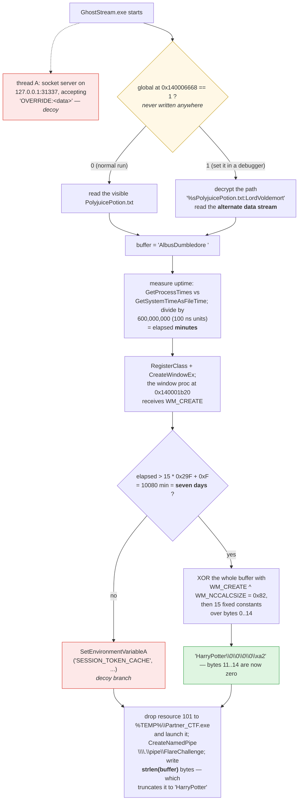
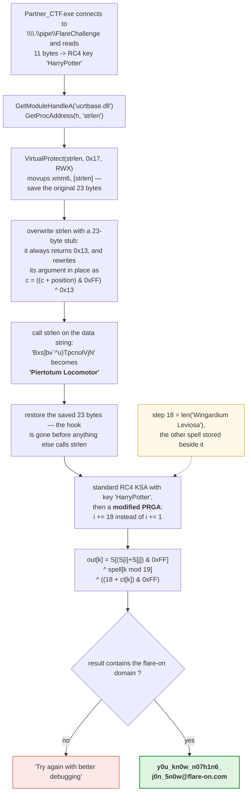

**Archive:** `2-GhostStream.7z` (password `flare`) · **Flag:** `y0u_kn0w_n07h1n6_j0n_5n0w@flare-on.com`

Flare-On is an annual reverse-engineering contest run by the FLARE team: each
challenge is a program that hides a "flag," a string ending in `@flare-on.com`,
and you have to work out from the compiled binary alone, with no source code, how
to get it out. This is challenge 2.

The challenge text for this one is unusually honest:

> *"Passing the baseline test was clearly a statistical fluke, so we've locked you
> in with a haunted executable and a botched vial of PolyjuicePotion.txt. It
> refuses to talk to the naked eye, and you aren't getting your nutrient paste
> until your debugger forces a confession out of it."*

Both halves are literal, and I read straight past both of them. The "ghost
stream" is an **NTFS alternate data stream**. NTFS, the Windows file system, lets
a file carry extra named streams of data next to its normal contents, and an
ordinary directory listing doesn't show them. The "haunted executable" patches a
function inside the C runtime (the standard library C programs on Windows call
into) at runtime, so that an ordinary `strlen` call, which should only count the
characters in a string, does something else entirely.

"Your debugger forces a confession out of it" isn't flavor either. A debugger
lets you pause a running program and read or change its memory. There is a branch
in this binary that nothing can reach without one, because the variable guarding
it is never written anywhere.

The overall shape: the parent program turns a hidden string into a password and
hands it to a second program it drops, which uses it to decrypt the flag. Two
processes, five chained transformations. I'll say up front that I never fully
nailed down the last one; that's at the end.

## Tools I used

A disassembler turns machine code back into readable assembly. An emulator runs a
program's instructions on a simulated CPU, where it can't touch the real machine
and can be stopped anywhere.

| Tool | What I used it for |
|---|---|
| `7z` | unpacking the `.7z`, then unpacking the **WIM** image inside it |
| `xxd` | reading the alternate data stream, and eyeballing the patch stub |
| `radare2` | disassembling both PE files (`parent_main.asm`, `child_main.asm`, 37 KB and 25 KB of listing) |
| `pefile` | pulling the embedded resources out, and mapping the image for emulation |
| **Unicorn** + `capstone` | emulating both binaries with every Win32 import stubbed out in Python, so I never ran Windows code |
| `python3` | reimplementing the modified RC4 and brute-forcing its two parameters |

I didn't run either executable. The parent drops and launches a second PE
(Portable Executable, the Windows format for `.exe` and `.dll` files), opens a
listening socket, and writes to `%TEMP%`, and I wanted to know what it did before
it did it.

Emulating it was slower than double-clicking would have been, but it's the only
reason I could read the `strlen` patch at all. Under a real debugger that hook is
installed and removed within a few instructions of each other; the emulator can
stop on any instruction and dump the patched bytes.

## A WIM, not an EXE

First surprise is in the archive layout: the `.7z` holds a `.wim`, not an
executable.

```console
$ 7z l 2-GhostStream.7z
   ...  GhostStream.wim
$ 7z x GhostStream.wim -owim
$ find wim -type f -exec ls -l {} +
-rw-r--r--  35328  wim/GhostStream/GhostStream.exe
-rw-r--r--    316  wim/GhostStream/PolyjuicePotion.txt
-rw-r--r--     18  wim/GhostStream/PolyjuicePotion.txt:LordVoldemort
```

That third file is the point of the whole challenge. A **Windows Imaging** (WIM)
image is Microsoft's file-based disk image format (Windows setup ships in one),
and unlike a ZIP it can store NTFS alternate data streams. `7z` extracts them as
literal filenames with a colon in them, the same `file:stream` notation Windows
uses. On macOS a colon is a perfectly legal byte in a POSIX filename, so the
hidden stream just... shows up as a file. (Finder will display it with a `/`
where the colon is, which is confusing until you remember the HFS legacy: the old
Mac file system used the colon as its path separator.)

If you extract this on Windows, Explorer shows two files and no indication the
third exists. `dir /r` shows it, and so do PowerShell's `Get-Item -Stream *` and
Sysinternals `streams`, but the normal file views don't.

Here's what's in it (`xxd` shows hex bytes with ASCII on the right):

```console
$ xxd 'wim/GhostStream/PolyjuicePotion.txt:LordVoldemort'
00000000: 416c 6275 7344 756d 626c 6564 6f72 6520  AlbusDumbledore
00000010: 0d0a                                     ..
```

Note the trailing space before the `\r\n` (the Windows line ending). That's 16
bytes of text, and the space matters later.

The joke is good, too: the stream is **named** `LordVoldemort` and **contains**
`AlbusDumbledore`. A file wearing somebody else's identity is exactly what
Polyjuice Potion does. The visible text file sets up the time gate:

> *"Ron took the initiative and added far too much boomslang skin to the
> cauldron. The potion has destabilized, and the transformation effect is now
> stuck for exactly 7 days."*

Remember "exactly 7 days." It's a literal constant in the binary.

## The parent

### Nothing useful in `strings`

The first thing I tried was the first thing everyone tries: `strings`, which
prints every run of readable characters in a file. It got me nothing. No API
names (the Windows functions a program calls), no paths, no pipe name. Everything
is built as stack strings, written into memory by instructions instead of stored
as text, and run through a decoder at `0x140001130`. The decoder's key comes from
the binary's own filename:

```
GetModuleFileNameA -> take the basename
key = basename[len/2] ^ basename[0]
```

`^` is XOR (exclusive or), which flips bits wherever the key has a 1; applying it
twice undoes it. For `GhostStream.exe`, 15 characters, the key is `basename[7] ^
basename[0]`, i.e. `'r' ^ 'G' = 0x35`. A checksum over the input then picks one
of three transforms; for every string I cared about it's `plain = enc - 2 + key`.

Which means **renaming the binary breaks it**. If you copy it to `sample.exe`
before analyzing it, the key changes, the strings decode to garbage, and you get
to spend an afternoon wondering why a working binary stopped working.

Two strings confirmed I'd read the decoder right (the first byte by hand: `0x29 -
2 + 0x35 = 0x5c`, a backslash):

| Encrypted (leading bytes) | Decoded |
|---|---|
| `29 29 fb 29 3d 36 3d 32 …` (23 B) | `\\.\pipe\FlareChallenge` |
| `f2 40 1d 3c 39 46 37 42 …` (35 B) | `%sPolyjuicePotion.txt:LordVoldemort` |

The first is a named pipe, a channel one process writes and another reads. The
second one is the challenge telling me the ADS is on the critical path, and it's
only visible once the decoder is understood. That's the design: you can't grep
your way to it.

### Gate 1: a flag that is never set

The parent spawns two threads (independent lines of execution inside one
process). The first runs a socket server that I'll get to under the decoys. The
second one does this:

```asm
0x140001a8c   cmp dword [0x140006668], 1
0x140001a93   jne skip
              ; decrypt "%sPolyjuicePotion.txt:LordVoldemort", sprintf the path, open it
```

If the global at `0x140006668` isn't 1, the ADS code is skipped. So I went
looking for the write to `0x140006668`. There isn't one. It's in zero-initialized
BSS (the section for global variables that start out as zero), and no instruction
anywhere in the binary stores to it.

I kept re-running the cross-references (the disassembler's list of every
instruction that touches an address), because surely I'd missed an indirect
write: a computed address, a `memset` over a containing struct, something. No. It
is read once and written never.

Which means **on any normal run, the ADS is never touched.** The parent reads the
visible `PolyjuicePotion.txt`, the chain produces garbage, and you get the
failure message. The only way through that branch is to attach a debugger, stop
on that `cmp`, and poke a 1 into memory yourself.

That's "until your debugger forces a confession out of it." An unreachable branch
is a signpost rather than a bug, but only if you trust your own cross-references
enough to believe what they're telling you.

### Gate 2: seven days of uptime

`0x140001680` resolves `GetProcessTimes` and `GetSystemTimeAsFileTime`, subtracts
the process's creation time from the current time, and then does this:

```asm
movabs rax, 0xe5109ec205d7bea7
sub    rdx, rcx
mul    rdx
shr    rdx, 0x1d
```

Compilers emit this pattern instead of the slow `div`: multiply by a precomputed
"magic" reciprocal, keep the high half, and shift. The magic constant tells you
the divisor. Here `0xe5109ec205d7bea7` with a 29-bit shift works out to 2^93 /
0xe5109ec205d7bea7, a division by **600,000,000**. FILETIME, the Windows
timestamp format, counts 100-nanosecond units, so 600,000,000 of them is **60
seconds**, and the value in that global is elapsed **minutes**.

Then the threshold, which is my favorite line in the binary:

```asm
imul esi, eax, 0x29f      ; eax = strlen("GhostStream.exe") = 15
add  esi, 0xf
```

`0x29f` is 671, so `15 * 671 + 15 = 10080`. Ten thousand and eighty minutes is
**exactly seven days**, which is what the story said. The threshold is computed
from the length of the executable's own filename, so this is the *second* thing
that silently breaks if you rename the file.

### The reveal, inside a window procedure

Here's where it stops being a normal flow. A Windows GUI program registers a
window class naming a window procedure: a callback that Windows calls for every
message the window receives (created, resized, clicked). The parent registers a
class with a procedure at `0x140001b20` and calls `CreateWindowEx`. The
transformation happens in the `WM_CREATE` handler, sent while the window is being
created.

That's a real obfuscation win for the author, because the window proc is called
by `user32` (the Windows library that manages windows), not by any code in the
binary. A static call graph shows it as unreferenced. Set a breakpoint on `main`
and single-step and you'll never reach it; the call comes from inside the
window-creation machinery.

If the potion has worn off (elapsed > 10080), the handler does:

```asm
; rolling XOR over strlen(buf); key = current_msg ^ previous_msg
xor byte [r10 + rdx], r11b
; then fifteen fixed constants
xor byte [rdx+0x0], 0x8b     xor byte [rdx+0x8], 0x94
xor byte [rdx+0x1], 0x8f     xor byte [rdx+0x9], 0x8b
xor byte [rdx+0x2], 0x92     xor byte [rdx+0xa], 0x95
xor byte [rdx+0x3], 0x85     xor byte [rdx+0xb], 0xe6
xor byte [rdx+0x4], 0x88     xor byte [rdx+0xc], 0xed
xor byte [rdx+0x5], 0x96     xor byte [rdx+0xd], 0xf0
xor byte [rdx+0x6], 0x98     xor byte [rdx+0xe], 0xe7
xor byte [rdx+0x7], 0x9b
```

The rolling key is `current message ID ^ previous message ID`, which means the
key depends on **the order Windows delivers messages in**. Windows sends
`WM_NCCALCSIZE` (`0x83`, which asks the window to size its frame) before
`WM_CREATE` (`0x01`), so the key is `0x01 ^ 0x83 = 0x82`.

Deriving a cipher key from the Windows message sequence is a horrible idea and I
rather admire it. It's stable in practice, and completely invisible if you're
reading the binary on its own.

Apply it:

```
AlbusDumbledore        41 6c 62 75 73 44 75 6d 62 6c 65 64 6f 72 65 20
XOR 0x82               c3 ee e0 f7 f1 c6 f7 ef e0 ee e7 e6 ed f0 e7 a2
XOR the 15 constants   48 61 72 72 79 50 6f 74 74 65 72 00 00 00 00 a2
                       H  a  r  r  y  P  o  t  t  e  r  \0 \0 \0 \0
```

The constants are chosen so that bytes 11 through 14 land on **exactly zero**. A
C string ends at its first zero byte (the NUL terminator), and the parent writes
`strlen(buffer)` bytes down the pipe, so the payload self-truncates to precisely
`HarryPotter`.

That self-truncation is what convinced me the chain was right rather than
coincidental. Getting eleven correct characters followed by a NUL terminator in
the right place is not something a wrong key does by accident. And Harry is the
character who actually drinks the potion, so the theme closes too.

### Decoys in the parent

There are a lot, and they're well-made:

- A **socket server on `127.0.0.1:31337`** that accepts `OVERRIDE:<data>` and
  transforms the payload with `(b ^ 0x33) + 5`. Completely functional, completely
  irrelevant. I spent real time on this one because a listening socket in a CTF
  binary *feels* like the intended path.
- `SetEnvironmentVariableA("SESSION_TOKEN_CACHE", ...)`, called only on the
  **not**-expired branch, i.e. the failure path. A name designed to look like the
  prize.
- `NtSetInformationThread(ThreadHideFromDebugger)`, which hides the thread from
  a debugger.
- A `Telemetry_%u_%x` name built from a PRNG (pseudo-random number generator)
  seeded with system info, which looks like it might be a second key and isn't.


<details markdown="1">
<summary>Mermaid source</summary>



</details>

## The child: `Partner_CTF.exe`

Resource `101` is a second 14,848-byte PE. Resources are data embedded in an
executable, usually icons; the parent drops this one to `%TEMP%\Partner_CTF.exe`
and launches it. Pulling it out with `pefile` takes about six lines:

```python
import pefile
pe = pefile.PE('GhostStream.exe')
for e in pe.DIRECTORY_ENTRY_RESOURCE.entries:
    for d in e.directory.entries:
        for r in d.directory.entries:
            o, sz = r.data.struct.OffsetToData, r.data.struct.Size
            open(f'res_{e.name}_{d.id}.bin','wb').write(pe.get_data(o, sz))
```

`res_None_101.bin` is the child. It connects to the pipe and reads the RC4 key
(RC4 is an old stream cipher, covered below).

### The haunting: an inline hook on `strlen`

This is the best part of the challenge, and it is why I'm glad I emulated instead
of debugged. An inline hook overwrites the start of a function in memory so that
every caller runs your code instead. The child hooks `strlen` in `ucrtbase.dll`,
the Universal C Runtime:

```asm
GetModuleHandleA("ucrtbase.dll")
GetProcAddress(hModule, "strlen")          ; -> rdi, later r14
VirtualProtect(r14, 0x17, PAGE_EXECUTE_READWRITE)
movups xmm6, [r14]                          ; save the original 23 bytes
mov    dword [r14], 0x1304c031               ; start overwriting
...
```

`GetProcAddress` returns a function's address in a loaded DLL, and
`VirtualProtect` makes those 0x17 (23) bytes of normally read-only code writable.
It saves `strlen`'s first 23 bytes in an XMM register and overwrites them with
its own stub. Then it calls `strlen`. Then it puts the original bytes back.

The stub is 23 bytes and is not a `strlen` at all:

```asm
31 c0        xor  eax, eax
04 13        add  al, 0x13        ; return value is always 19
b2 01        mov  dl, 1
75 01        jnz  +1              ; jumps over the next byte (0xE8)
00 11        add  byte [rcx], dl  ; *p += position
30 01        xor  byte [rcx], al  ; *p ^= 0x13
fe c2        inc  dl
48 ff c1     inc  rcx
38 21        cmp  byte [rcx], ah  ; ah = 0, so: stop at the NUL
75 f3        jnz  loop
c3           ret
```

Two things to notice. It **mutates its argument in place**: a `strlen` with a
side effect. And that `jnz +1` is a one-byte jump over a stray `0xE8` (left out
of the listing above) to break naive disassembly. `0xE8` is the opcode for
`call`, so if you read the bytes linearly you'll see a call that isn't there.

Net effect: every byte becomes `((c + position) & 0xFF) ^ 0x13`, with position
starting at 1, and the return value is a hardcoded 19. Applied to a string
sitting in the child's data section:

```
Bxs]bv`^u)TpcnolVjN   ->   Piertotum Locomotor
```

`Piertotum Locomotor` is the spell that animates the castle's statues. Stored
right next to it in the clear is `Wingardium Leviosa`, which looks like
decoration and isn't.

Then `strlen` is restored, so if you breakpoint anywhere later and dump the
function, it looks untouched.

### The cipher

RC4 turns a key into a stream of pseudo-random bytes (the keystream) and XORs it
with the data. The key schedule (KSA) shuffles a 256-entry table using the key;
the generator (PRGA) keeps shuffling it and emits one keystream byte per data
byte. Key scheduling is textbook RC4 with the pipe payload (`HarryPotter`) as the
key. The PRGA is not textbook:

```python
def decrypt(key, ct, spell=b"Piertotum Locomotor", step=18, add=18):
    S = list(range(256)); j = 0
    for i in range(256):                        # standard KSA
        j = (j + S[i] + key[i % len(key)]) & 0xff
        S[i], S[j] = S[j], S[i]
    i = j = 0
    out = bytearray()
    for k, c in enumerate(ct):
        i = (i + step) & 0xff                   # <- step, not +1
        j = (j + S[i]) & 0xff
        S[i], S[j] = S[j], S[i]
        K = S[(S[i] + S[j]) & 0xff]
        out.append(K ^ spell[k % len(spell)] ^ ((add + c) & 0xff))
    return bytes(out)

ct = bytes.fromhex("965c8735d77a398b75046d28bb5658c835eedae1a456a937"
                   "811556f9270a340dee822c26a5f8")

print(decrypt(b"HarryPotter", ct))
# b'y0u_kn0w_n07h1n6_j0n_5n0w@flare-on.com'
```

Three modifications stacked on top of RC4: the index steps by 18 instead of 1,
the keystream is XORed with the spell string, and the ciphertext byte has 18
*added* before being XORed in. The step value **18** is `len("Wingardium
Leviosa")`, which is why the other spell is stored in the binary.


<details markdown="1">
<summary>Mermaid source</summary>



</details>

## The bit I never fully resolved

I'm leaving this in because it's the honest state of my analysis.

Statically, **both** `strlen` call sites in the child go through the same import
thunk (the slot the Windows loader fills with an imported function's address),
and the hook is not removed until after the second call. So the second call
should also hit the stub, which always returns `0x13` = **19**. That would make
the step 19, not 18.

Only **18** reproduces the flag. I checked exhaustively. The parameter space here
is tiny (step and add are both single bytes, the spell is one of two strings, so
256 × 256 × 2 candidates), so I just enumerated it and looked for output
containing `@flare-on.com`. Exactly one combination hits, and it's step 18.

My best explanation: on a real Windows system the import
`api-ms-win-crt-string-l1-1-0.dll!strlen` and
`GetProcAddress(GetModuleHandleA("ucrtbase.dll"), "strlen")` **do not resolve to
the same code**. API sets (the `api-ms-win-…` names) sit between the DLL name a
program imports and the DLL that implements it. API sets are forwarder DLLs, and
the loader can bind the import to a jump thunk while `GetProcAddress` returns the
real implementation. Patch one and the other still works. If that's what happens,
the second call returns the true length of `Wingardium Leviosa`, 18, and
everything lines up.

I could not confirm that without a Windows box, and I'd rather write down a
hypothesis I couldn't test than present a brute-force result as if I'd derived
it. If you've got a Windows machine and you check this, I'd like to know.

## On emulating instead of running

Both binaries went through Unicorn with the entire import table (the DLL
functions a program needs) redirected to Python handlers. The part that made the
`strlen` trick reproducible is small:

```python
STRLEN = 0x00500000
# a real strlen(rcx), assembled by hand
STRLEN_CODE = bytes.fromhex("31C0" "803C0100" "7405" "48FFC0" "EBF5" "C3")
mu.mem_write(STRLEN, STRLEN_CODE)

for entry in pe.DIRECTORY_ENTRY_IMPORT:
    for imp in entry.imports:
        if imp.name == b'strlen':
            mu.mem_write(addr, struct.pack("<Q", STRLEN))   # import slot
            continue
        ...
def hook(mu, address, size, ud):
    ...
    elif name == 'GetProcAddress':
        if cstr(rdx) == b'strlen':
            res = STRLEN          # same address the import points at
```

I put a working `strlen` implementation in emulator memory, pointed both the
import slot *and* `GetProcAddress("strlen")` at it, and let the binary patch it
exactly as it would on Windows. Then the dumped output buffer matched my Python
reimplementation byte for byte. (This is also the configuration in which the step
would be 19, which is how I know my static reading was consistent, and why I
suspect the discrepancy is a Windows loader behavior I'm not modeling.)

For the parent, I turned `CreateThread` and `CreateWindowEx` into tail calls
(jumping straight into the thread function or window procedure) so the thread
bodies and the window procedure actually executed, in order, and made the timing
APIs report eight days of uptime. That reproduced the exact eleven bytes written
to the pipe.

## The chain, end to end

| Step | Mechanism | Result |
|---|---|---|
| 1 | NTFS alternate data stream inside a WIM | `AlbusDumbledore ` |
| 2 | Patch `0x140006668` to 1 in a debugger | parent reads the ADS, not the visible text |
| 3 | Elapsed time > 10080 minutes (7 days) | window proc takes the reveal branch |
| 4 | XOR `0x82` + 15 constants, then `strlen` truncation | `HarryPotter` |
| 5 | Named pipe to the child | the RC4 key |
| 6 | Self-removing inline hook on `ucrtbase!strlen` | the spell `Piertotum Locomotor` |
| 7 | Modified RC4, step 18 = `len("Wingardium Leviosa")` | the flag |

What strikes me looking at that table is that not one stage uses an actual
secret. A filename length. The order Windows delivers window messages in. The
length of a string sitting in a different part of the file. The return value of a
library function that has been temporarily replaced.

There's nothing in this binary you could call a key, which is why `strings` gives
you nothing and why renaming the file breaks it in two separate places.

**Flag:** `y0u_kn0w_n07h1n6_j0n_5n0w@flare-on.com`
