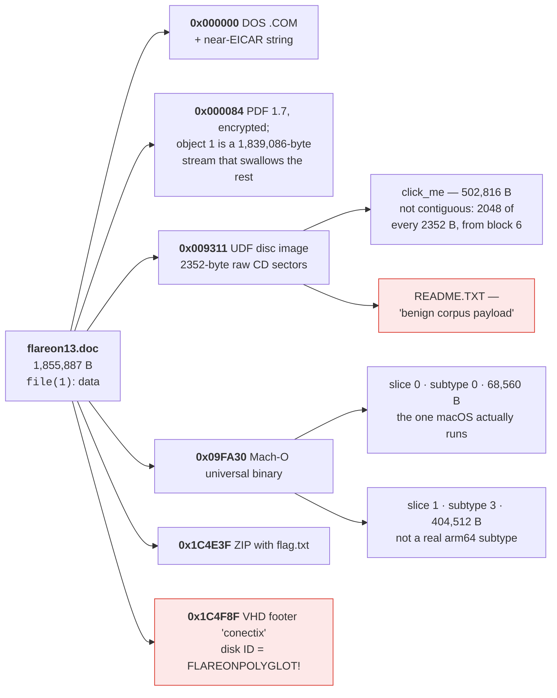
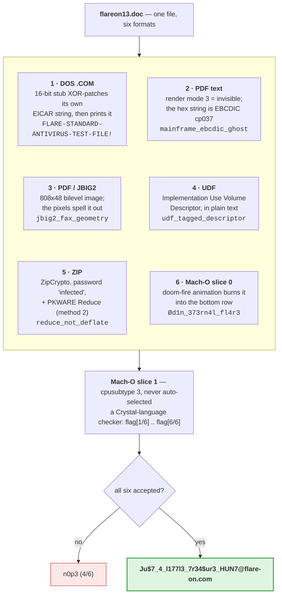

**Archive:** `3-flareon13_doc.7z` (password `flare`), containing `flareon13.doc` · **Flag:** `Ju$7_4_l177l3_7r34$ur3_HUN7@flare-on.com`

This is the one I enjoyed most in the whole set, and it's the one that took the
widest range of tools. `flareon13.doc` is 1,855,887 bytes and it is **not a Word
document**. It is six different file formats at the same time. Each format hides
one token, and a checker buried inside the file wants all six.

Some background if this isn't your field. Flare-On is the FLARE team's yearly
reverse-engineering contest, and each challenge hides a flag ending in
`@flare-on.com`. This one is a **polyglot**, a single file that is valid in
several formats at once. That works because formats are recognized by a few
fixed bytes at a known position (*magic bytes*) and each parser reads only what
it cares about: a PDF reader looks near the start, a ZIP reader looks at the end.

`file(1)`, the Unix tool that identifies files by their magic bytes, gives you
nothing at all:

```console
$ file flareon13.doc
flareon13.doc: data
```

Which is encouraging, actually. `data` means nothing matched at offset zero and
nothing matched any of libmagic's heuristics either. On a file this large that
usually means the structure is somewhere other than the front.

## Tools I used

This challenge is basically a tour of file-format tooling, so the list is long:

| Tool | What I used it for |
|---|---|
| `binwalk`, `xxd`, `python3` | finding the six embedded structures and their offsets |
| `qpdf` | decrypting the PDF (RC4-40, empty user password) and expanding it to QDF form |
| `poppler` (`pdftoppm`, `pdfimages`) | rendering the page and extracting the **JBIG2** image |
| `python3` + `pypdf` | reading the content stream and the EBCDIC text object |
| a hand-written **UDF parser** (~40 lines) | the descriptors aren't at standard offsets, so no off-the-shelf tool found them |
| a hand-written **ZipCrypto** implementation | Python's `zipfile` won't decrypt, and nothing I have decompresses PKWARE Reduce |
| `otool` / `lipo` / `nm` / `codesign` | taking apart the Mach-O universal binary |
| `radare2` | disassembling both Mach-O slices (`s0.asm` 26 KB, `s1.asm` 1.9 MB) |
| `r2ghidra` (Ghidra's decompiler inside `radare2`) | pseudocode for slice 0's frame loop, to settle the 19-byte `memcpy` |
| a 16-bit x86 disassembler (by hand, honestly) | the DOS `.COM` stub at offset 0 |
| `pillow` | cropping and zooming the JBIG2 output |

## The layout


<details markdown="1">
<summary>Mermaid source</summary>



</details>

The PDF is the outer wrapper and the reason this works at all. A PDF *stream* is
a block of raw data whose declared length the parser simply skips. Object 1 is a
stream declared as 1,839,086 bytes long, which swallows almost the entire file.
Everything else (the disc image, the Mach-O, the ZIP) lives *inside* that stream
as far as a PDF parser is concerned, and lives at its own offset as far as every
other parser is concerned.

## 1. The DOS stub, which is not EICAR

The file opens with something that looks like the EICAR antivirus test string
and isn't. (EICAR is a harmless, all-printable DOS program that every antivirus
product flags on purpose, so people can test their scanners.)

```
h  X5`!P[h @X5#`0G h @X5%`0G!h @X5"`0G"h @X53`0G#h @X57`0G$h  X5@!PZ
h  X5|!P[h  X5[)P^)7CC)7H+H*EICAR-STANDARD-ANTIVIRUS-TEST-FILE!$
```

I nearly skipped past this. It *renders* as near-ASCII junk followed by a string
I've seen a thousand times. But those `h ` groups are 16-bit x86, the machine
code DOS runs: `0x68` is `PUSH imm16` (push a two-byte constant), and the whole
prologue is push/pop/xor sequences that construct register values without ever
containing a literal byte an AV signature would match.

(For newcomers: `ax`, `bx`, `dx`, `si` are registers, `ah`/`al` the two halves
of `ax`, and `[bx+0x20]` the memory at `bx + 0x20`.)

```asm
push 0x2020 / pop ax / xor ax, 0x2160   ; bx = 0x0140
push 0x4020 / pop ax / xor ax, 0x6023   ; al = 0x03
xor  byte [bx+0x20], al                 ; patch file offset 0x60
...                                      ; al = 0x05, 0x02, 0x13, 0x17
push 0x2020 / pop ax / xor ax, 0x2140   ; dx = 0x0160   (string pointer)
push 0x2020 / pop ax / xor ax, 0x217c   ; bx = 0x015c
push 0x2020 / pop ax / xor ax, 0x295b   ; si = 0x097b   (so ah = 0x09)
sub  word [bx],   si                     ; the two bytes "H+" become INT 21h
sub  word [bx+2], si                     ; the two bytes "H*" become INT 20h
```

`radare2` (an open-source disassembler) reads the same bytes the same way when
told the file is 16-bit code loaded at `0x100` (`r2 -a x86 -b 16 -m 0x100`),
which is how I checked the hand listing above:

```text
0000:0100     682020         push 0x2020
0000:0103     58             pop ax
0000:0104     356021         xor ax, 0x2160
0000:0107     50             push ax
0000:0108     5b             pop bx               ; bx = 0x0140
0000:0109     682040         push 0x4020
0000:010c     58             pop ax
0000:010d     352360         xor ax, 0x6023       ; al = 0x03
0000:0110     304720         xor byte [bx + 0x20], al
...
0000:0144     682020         push 0x2020
0000:0147     58             pop ax
0000:0148     357c21         xor ax, 0x217c
0000:014b     50             push ax
0000:014c     5b             pop bx               ; bx = 0x015c
0000:014d     682020         push 0x2020
0000:0150     58             pop ax
0000:0151     355b29         xor ax, 0x295b
0000:0154     50             push ax
0000:0155     5e             pop si               ; si = 0x097b
0000:0156     2937           sub word [bx], si
0000:0158     43             inc bx
0000:0159     43             inc bx
0000:015a     2937           sub word [bx], si
0000:015c     48             dec ax               ; "H+" and "H*": the bytes that become INT 21h / INT 20h
0000:015d     2b482a         sub cx, word [bx + si + 0x2a]
0000:0160     45             inc bp               ; "EICAR-STANDARD-..." read as code from here on
```

The comments are mine. Everything from `0x15c` onward is the ASCII string being
decoded as instructions, which is why a linear disassembly of the file looks
like garbage past the two `sub word [bx], si`.

The subtraction checks out: `H+` is the little-endian word `0x2B48`, and
`0x2B48 - 0x097B = 0x21CD`, stored as `CD 21`, which is `INT 21h`. `H*` becomes
`CD 20`, `INT 20h`.

A `.COM` program is the simplest DOS executable, with no header: DOS loads it at
`0x100`, after 256 bytes of its own bookkeeping, and jumps there. So `0x160` is
file offset `0x60`: the first byte of `EICAR`. The five XOR values rewrite
exactly five characters:

```
E ^ 0x03 = F    I ^ 0x05 = L    C ^ 0x02 = A    A ^ 0x13 = R    R ^ 0x17 = E
```

`INT 21h` is the DOS service call, and `AH = 0x09` selects "print `$`-terminated
string," with `DX` pointing at it. So the program prints

```
FLARE-STANDARD-ANTIVIRUS-TEST-FILE!
```

and exits (`INT 20h`). It even patches
the two `INT` instructions into existence out of ASCII bytes, so the raw file
contains no interrupt opcodes.

What I like about this: the bytes on disk are *not* the EICAR string, so the file
is not an AV test file and doesn't get quarantined on the way to you. Anybody who
runs it sees that it meant to be one.

**Token 1: `FLARE-STANDARD-ANTIVIRUS-TEST-FILE!`**

## 2 and 3. The PDF

The PDF starts at `0x84` and is encrypted: `/Filter /Standard /V 1 /R 2`, which
is 40-bit RC4. That sounds like a wall and isn't. It opens with an **empty user
password**, the standard "owner restrictions only" setup: the user password
gates opening the file, the owner password only gates permissions like printing,
so any reader can derive the key. `qpdf` writes a decrypted copy, expanded to
QDF form (uncompressed and readable in a text editor):

```console
$ qpdf --decrypt --password= --qdf --object-streams=disable doc.pdf dec.pdf
```

Rendering the page gives you a giant FLARE-ON logo, drawn as vectors, on a
14400 x 14400 page with `/UserUnit 75000`:


### Invisible text

At the end of the content stream, the page's list of drawing commands:

```
BT /F1 1 Tf 3 Tr 50 50 Td <9481899586998194856d8582838489836d878896a2a3> Tj ET
```

`Tj` draws the hex string, and `3 Tr` is **text rendering mode 3**: neither
filled nor stroked, i.e. invisible. It's a real text object, it's in the page,
and it draws nothing.

The hex string isn't ASCII either; almost every byte is above `0x7F`. The giveaway is
`0x6d` repeating at two positions where you'd expect a separator, and `0x6d` is
underscore in **EBCDIC**, IBM's mainframe character encoding (Python calls the
US variant `cp037`):

```python
>>> bytes.fromhex('9481899586998194856d8582838489836d878896a2a3').decode('cp037')
'mainframe_ebcdic_ghost'
```

The token names the trick, which is a kindness. **Token 2:
`mainframe_ebcdic_ghost`**

### The JBIG2 image

Object 7 is an 808 x 48, 1-bit image with `/Filter /JBIG2Decode`. JBIG2 is the
bilevel (black-or-white) fax codec and almost nothing implements it, but
poppler, the open-source PDF library, does. I ran it on the copy qpdf had
already decrypted:

```console
$ pdfimages -png dec.pdf out
$ ls out-*.png
out-000.png
```


The token is written out in the pixels.

**Token 3: `jbig2_fax_geometry`**

## 4. The UDF disc image

UDF (Universal Disk Format) is the file system on DVDs and many CDs. This is
where the off-the-shelf tools stopped helping. The UDF descriptors (the records
describing the volume and its files) are **not at their standard offsets**, so
every tool I pointed at the file said it wasn't a disc image.

UDF descriptors carry a 16-byte tag with a checksum (byte 4 is the low byte of
the sum of the other fifteen) and the sector number the descriptor believes it
sits in, its *tag location*. So I scanned for valid tags instead of trusting
offsets:

```python
def tag_ok(b):
    return sum(b[:4]) + sum(b[5:16]) & 0xFF == b[4]
```

Two anchor descriptors turned up, at tag locations 256 and 525, sitting at file
offsets `0x93010` and `0x12D780` (the anchor is what a UDF reader looks for
first; it points at everything else). Two known sectors at two known offsets,
and the ratio gives the geometry immediately:

```
(0x12D780 - 0x93010) / (525 - 256) = 2352
```

**2352-byte raw CD sectors**: the full Mode 1 sector, with its 16-byte header and
2048 bytes of user data; the other 288 bytes are error correction. That's why
nothing recognized it. Every tool assumes 2048-byte logical blocks.

```
file_offset(sector) = 16 + sector * 2352
```

There's no base offset beyond the 16-byte header, so sector 0 lines up with byte
0: the disc image spans the whole file. UDF leaves its first 16 sectors unused,
which is where the DOS stub and the PDF header live.

The partition starts at sector 272, and walking the file entries from there:

```
FE @blk4:  filetype=5  infolen=502816   extent: 502816 B @ block 6    -> click_me
FE @blk5:  filetype=5  infolen=22       extent: 22 B     @ block 252  -> README.TXT
```

A file entry (FE) describes one file: type 5 is a regular file, `infolen` its
size, the extent where its data sits. Block 6 of the partition is sector 278,
and `16 + 278 * 2352` is `0x9FA30`, exactly where the Mach-O shows up.

`README.TXT` says `benign corpus payload`, which is a joke and not a token.

The actual token is sitting in **plain text** in the Implementation Use Volume
Descriptor (where the authoring software describes itself), right next to
`DiscRecording Framework` and `*UDF LV Info`:

```
udf_tagged_descriptor
```

**Token 4: `udf_tagged_descriptor`**

### The part that actually mattered

This is the bit I got wrong, and it set me back further than anything else in
the challenge.

`click_me` is a Mach-O (macOS executable), specifically a universal one: several
executables, one per CPU type, behind a header starting with `0xCAFEBABE`. I found
it by scanning for `0xCAFEBABE` and carved it out by length (cut that many bytes
out of the big file). `file` said universal binary. `lipo -detailed_info`
worked. It looked completely fine, and it was completely broken: `__stubs` (the
jump table for imported functions) empty, string table blank, 93 of its 133
512-byte blocks all zeros.

Which, in hindsight, is obvious. File data in this image lives in 2048-byte
chunks inside 2352-byte sectors, so a contiguous carve swallows 304 bytes of
sector header and ECC every 2352 bytes. It only looked valid because the Mach-O
header happened to land inside the first chunk.

The fix is to reassemble from the UDF extents, 2048 data bytes per sector:

```python
SEC, BASE, DATA, PART = 2352, 16, 2048, 272
def block(n):
    o = BASE + (PART + n) * SEC
    return data[o : o + DATA]

click_me = b''.join(block(6 + i) for i in range(246))[:502816]
```

```console
$ shasum click_me udf_FE@blk4.bin
# identical — and now nm, otool and radare2 all agree
```

The lesson I'd actually write on a sticky note: **a carve that produces a file
your tools accept is not a carve that produced the right file.** Check a
structure that spans the whole file (a string table, a symbol table, a checksum),
not just the header.

## 5. The ZIP

The trailing ZIP at `0x1C4E3F` has one entry:

```
flag.txt    compression method 2     flags 0x0001 (encrypted)
            CRC 0x25130DEA           compressed 222    uncompressed 18
```

Method 2 is PKWARE **Reduce**, from 1989, long before Deflate (method 8, what
nearly every ZIP uses). Python's
`zipfile` doesn't implement it. Neither does 7-Zip. Neither does Info-ZIP.
That's the whole joke, and the token says so.

The encryption is legacy ZipCrypto, the original ZIP password scheme, which is
about thirty lines to implement. Candidate passwords: the conventional one for
shared malware samples is `infected`, and that's it. The 12-byte header ZipCrypto
puts before the data is how you know you're right once decrypted:

```
11 22 33 44 55 66 77 88 99 aa bb 25
```

ZipCrypto's header check only verifies **one byte**: the last must equal the high
byte of the CRC, and `0x25` matches `0x25130DEA`. A one-byte check gives you
a 1-in-256 false positive rate, which is far too loose to trust on its own. But
`11 22 33 44 55 66 77 88 99 aa bb` is clearly hand-written, not random, so this
isn't a coincidental hit.

The payload turned out not to need a Reduce decompressor at all: 192 zero bytes
(empty Reduce follower sets) followed by the literal text. Follower sets are
Reduce's per-byte-value tables of likely next bytes; 256 empty ones are 256
six-bit zeros, or 192 bytes. The sizes agree: 222 compressed minus the 12-byte
header is 210, which is 192 plus the 18-byte token.

**Token 5: `reduce_not_deflate`**

## 6. The Mach-O universal binary

```console
$ lipo -detailed_info click_me
Fat header in: click_me
architecture (null)
    cputype 16777228  cpusubtype 0   offset 16384  size 68560
architecture (null)
    cputype 16777228  cpusubtype 3   offset 98304  size 404512
```

Both slices claim arm64 (`cputype 0x100000C`), the CPU of Apple Silicon Macs,
and the subtype names the variant. `cpusubtype 0` is
`ARM64_ALL`. `cpusubtype 3`... isn't anything. There is no arm64 subtype 3 in
`mach/machine.h`. The kernel's fat-binary selector will never pick it, so
**slice 1 never runs** unless you extract it yourself (the `lipo` offset and size
are all you need). `lipo` prints `architecture (null)` for both because it can't
name either one.

Which is an excellent hiding place. A second executable, in the same file, on the
same architecture, that the OS will never choose.

### Slice 0: the fire

Before running anything, I checked what it *could* do. `nm -u` lists the
functions it imports from system libraries:

```console
$ nm -u cm_slice0.bin
__tlv_bootstrap
_bzero
_memcpy
_memmove
_ptrace
_usleep
_write
```

Seven imports, and when I grepped the disassembly there were **no `svc`
instructions** (`svc` is how arm64 code calls the kernel directly), so no raw
syscalls. It cannot open a file, touch the network, or spawn anything. The worst
it can do is write to my terminal. That's what made it safe to run, and I want
to be explicit that this was the reasoning, not a vibe.

(`_ptrace` is there for `PT_DENY_ATTACH`, request 31, which makes macOS refuse
debuggers: anti-debug, no added capability.)

The `__const` section XORed with `0x80` gives up the whole
aesthetic:

```
\e[38;5;52m  \e[38;5;124m  \e[38;5;196m
\e[38;5;208m \e[38;5;220m  \e[38;5;231m
 .,:;=+*oahHGM#
```

The `\e[38;5;Nm` codes set the terminal's text color from its 256-color palette,
here a dark-red-to-white ramp, and the third line is a density ramp (sparse to
dense characters). That's a **doom fire**: the flame effect from the 1995 PlayStation port of Doom, which
is a well-known demo. And it is:


**Token 6: `Ød1n_373rn4l_fl4r3`**

And now the detail that will waste your time if you miss it: that first
character is a real UTF-8 `Ø`, two bytes `C3 98`, and **not a zero**. In a fire
animation rendered in orange on black, at terminal font size, `Ø` and `0` look
near-identical.

I confirmed it from the code rather than my eyes: the routine `memcpy`s exactly
`0x13` = **19** bytes for that line. `Ød1n_373rn4l_fl4r3` is 18 characters but
**19 bytes** in UTF-8, because `Ø` takes two. The ASCII variant `0d1n_373rn4l_fl4r3` is 18. The byte
count settles it, and feeding the checker the `0` version is rejected.

Here is that routine, since it's the whole argument. `radare2` with the Ghidra
decompiler plugin (`r2ghidra`) on the reassembled slice 0, around the third of
the three `memcpy` calls in `main`. (In arm64, `csel` picks a value based on the
last `cmp`, `bl` is a call, and `memcpy`'s length goes in `x2`.)

```text
0x100000f68      mov w8, 0xffd2
0x100000f74      sub x8, x8, x25          ; room left in the line buffer
0x100000f78      cmp x8, 1
0x100000f7c      b.lt 0x100000f9c
0x100000f80      cmp x8, 0x13
0x100000f84      mov w9, 0x13
0x100000f88      add x1, sp, 0x1c, lsl 12 ; the source: a buffer on the stack
0x100000f8c      csel x2, x8, x9, lo      ; n = min(room, 0x13)
0x100000f90      add x0, x26, x21
0x100000f94      add x1, x1, 0xe10
0x100000f98      bl sym.imp.memcpy
```

and the decompiler's C-like view of the same stretch, with the two `"\x1b[0m"`
color resets that bracket it:

```c
sVar6 = 0xfffe - iVar15;
if (0 < sVar6) {
    if (3 < sVar6) { sVar6 = 4; }
    sym.imp.memcpy(auStack_1bcfc + iVar15 + -2, "\x1b[0m", sVar6);
}
...
sVar6 = 0xffd2 - iVar15;
if (0 < sVar6) {
    if (0x12 < sVar6) { sVar6 = 0x13; }
    sym.imp.memcpy(&uStack_1bcd8 + iVar15 + 6, &uStack_180, sVar6);   /* 19 bytes */
}
sVar6 = 0xffbf - iVar15;
if (0 < sVar6) {
    if (3 < sVar6) { sVar6 = 4; }
    sym.imp.memcpy(&uStack_1bcc0 + iVar15 + 1, "\x1b[0m", sVar6);
}
auStack_1bcbb[iVar15] = 10;
sym.imp.write(1, &uStack_1bd00, iVar15 + 0x46);
sym.imp.usleep(33000);
```

`0x13` is a clamp, not a `strlen`: the copy is capped at nineteen bytes
whatever is in the buffer, which only makes sense if the author knew the token
was nineteen bytes long. The frame loop ends with one `write(2)` of the whole
assembled frame to file descriptor 1 (the terminal) and a 33 ms sleep, which is
the animation's frame rate, roughly 30 frames a second.

Bait strings in the same slice, for completeness:

```
totally_fake_fla
Strings? Where we're going, we don't need strings.
```

### Slice 1: the checker

A **Crystal**-language binary. Crystal (a compiled, Ruby-like language) statically
links its runtime, which is why it's 404 KB, and the author has leetspeak-mangled
the entire runtime string table specifically to ruin `strings` (the tool that
dumps readable text from a binary) for you:

```
N3g471v3 c4p4c17y             <- "Negative capacity"
1nd3x 0u7 0f b0und$           <- "Index out of bounds"
p4$$1ng 4 cl0$ur3 70 C ...    <- "passing a closure to C ..."
```

Those are *runtime panic messages*, so mangling them costs nothing functionally
and makes the binary look like it's stuffed with flag-shaped garbage. The actual
program strings are short and buried in the noise:

```
flag[      ]>      n0p3 (
```

It prompts six times and scores you:

```console
$ ./checker
flag[1/6]> ...
flag[2/6]> ...
...
flag[6/6]> n0p3 (4/6)
```

Order doesn't matter; it takes the six as a set. I looked for the expected
values in the binary as literals, as XORed data, and as common hashes, and
they're not there in any of those forms. They have to come from the file.

That is the point of the whole challenge. You can't crack the checker in
isolation; it only verifies work you did everywhere else.

```console
$ printf '%s\n' jbig2_fax_geometry reduce_not_deflate udf_tagged_descriptor \
    'Ød1n_373rn4l_fl4r3' 'FLARE-STANDARD-ANTIVIRUS-TEST-FILE!' \
    mainframe_ebcdic_ghost | ./checker
Ju$7_4_l177l3_7r34$ur3_HUN7@flare-on.com
```

## The solve, end to end


<details markdown="1">
<summary>Mermaid source</summary>



</details>

## Decoys

The misdirection is good:

- The **VHD footer** (VHD is Microsoft's virtual disk format, `conectix` its
  magic string) at the very end is valid, and it is *also* the ZIP archive
  comment, so neither structure corrupts the other. Its disk unique ID reads
  `FLAREONPOLYGLOT!`. It contains no token, which I refused to believe for far
  longer than I should have.
- `README.TXT`, which says `benign corpus payload`.
- `totally_fake_fla` and `true_honest_flag` as bait strings.
- The fat header advertises slice offsets that are only correct **after** you
  reassemble the file from the disc image, so a naive carve gives you a Mach-O
  that parses and doesn't work.

## A note on running things

Two binaries got executed here, and in both cases I checked capability first.
Slice 0's import table has seven symbols and the disassembly has no syscall
instructions, so stdout is the entire attack surface. The Crystal checker
imports no socket, `fork` or `exec` functions; it ran in a scratch directory
with its input piped in and a hard timeout.

These are challenge binaries from a vendor I trust, so this isn't really about
them. It's that "I trusted the source" stops being an argument the first time you
work a supply-chain incident, and reading an import table costs you a minute.

**Flag:** `Ju$7_4_l177l3_7r34$ur3_HUN7@flare-on.com`
