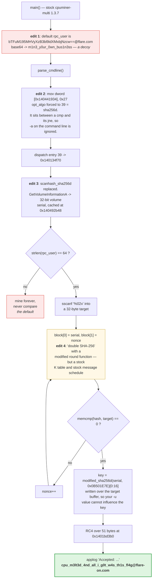

**Archive:** `4-ToxicMiner.7z` (password `flare`), containing `ToxicMiner.exe` · **Flag:** `cpu_m3lt3d_4nd_all_i_g0t_w4s_th1s_fl4g@flare-on.com`

> *"We've chained your terminal to a rogue CPU miner that has zero interest in
> the blockchain and every interest in turning your processor into
> weapons-grade slag. Dissect the binary before you bake alive, or at least
> generate enough hash rate to pay off the electricity bill for your
> captivity."*

That last clause isn't flavor text. The intended solution really is a brute
force (trying every possible value of a secret until one works), and the flag
jokes about it.

This one is a cryptocurrency miner. Mining means hashing a block of data over
and over, bumping a counter called the *nonce* each time, until the output
meets a target. A hash function turns any input into a fixed-size fingerprint
and can't be run backward, so the only way to hit a particular output is to
keep guessing. Miners are brute-force machines by design, and this challenge
leans on that.

Most of my time on this one went nowhere near the analysis, which was fine. It
went on a bug in my **own** search harness (the small program I wrote to run
the brute force) that made four separate exhaustive sweeps come back empty.
That's the useful part of this write-up, and it gets its own section at the end.

## Tools I used

`pefile` parses Windows executables. Capstone and radare2 are disassemblers
(machine-code bytes back to assembly), Ghidra's decompiler goes on to C-like
pseudocode, and Unicorn is a CPU emulator that runs a piece of machine code on
its own.

| Tool | What I used it for |
|---|---|
| `pefile` | sections, imports, resources, and mapping the image for the brute force |
| `capstone` | disassembling the handful of functions that mattered |
| `radare2` | navigating 4.8 MB of statically-linked everything |
| `r2ghidra` (Ghidra's decompiler inside `radare2`) | pseudocode for the replaced `scanhash`, the key derivation and RC4 |
| `strings` + `grep` | mostly to learn how useless `strings` is here |
| **Unicorn** | running the modified hash in isolation before I trusted it |
| `clang -arch x86_64 -mno-red-zone` + `pthread` | the actual key search, calling the binary's own code under **Rosetta 2** |
| `python3` | RC4, known-answer tests, and the reference SHA-256 I compared against |

The interesting choice here is the `clang` row. I did not reimplement the
modified hash. I mapped the PE image into an x86-64 process at its native image
base and **called the function straight out of the binary**. On an Apple M4
Pro that runs under Rosetta 2 (Apple's translator for Intel code on ARM Macs),
and it's still fast enough to sweep all 2^32 values (about 4.3 billion) in
minutes.

## What it is

4.8 MB PE32+ console binary (PE32+ is the 64-bit flavor of the Windows
executable format). Under all of it is **cpuminer-multi 1.3.7 by tpruvot**, an
open-source miner, statically linked against OpenSSL and libcurl (their code is
compiled into the EXE instead of loaded from DLLs), essentially unmodified.

That's the real defense. `strings`, which dumps every run of printable text in
a file, gives you about 15,000 lines of genuine miner, TLS and HTTP noise.
Every CA name, every OpenSSL error string, every stratum message (stratum is the protocol miners use
to talk to a mining pool). There is no "suspicious string" to find, because
everything looks exactly as suspicious as a real miner does. tpruvot's actual
donation address, `1FhDPLPpw18X4srecguG3MxJYe4a1JsZnd`, is in there too.

The author made **four** targeted edits to that public code, and finding them is
the challenge.


<details markdown="1">
<summary>Mermaid source</summary>



</details>

## Edit 1: a flag-shaped decoy

`main()` sets the default `rpc_user`, the username the miner sends to the pool
(normally set with `-u`), to

```
bTFuM195MHVyXzB3bl9idXMxbjNzcw==@flare.com
```

which base64-decodes (base64 is a reversible text encoding, not encryption) to
`m1n3_y0ur_0wn_bus1n3ss`, "mine your own business." It's shaped like a pool
login, it sits among 15,000 other strings, and it looks exactly like a flag.

The tell is the domain: `@flare.com`, not the `@flare-on.com` every Flare-On
flag ends in.

I noticed that, and then talked myself out of it while my brute force was
failing, on the theory that the author had typo'd it. He hadn't. I made the same
mistake again, much worse, in challenge 9. When a candidate almost matches the
flag format, the mismatch is the evidence, and I should have read it that way
instead of correcting it in my head.

## Edit 2: your `-a` flag is a lie

cpuminer picks its hashing algorithm from the `-a` option. Immediately after
`parse_cmdline`, the function that reads the command line, this runs
unconditionally:

```asm
0x140100324  call 0x140103180                  ; parse_cmdline
0x140100329  cmp  dword [0x140491ac4], 0       ; opt_n_threads == 0 ?
0x140100330  mov  dword [0x140491aa8], 1
0x14010033a  mov  dword [0x140441934], 0x27    ; opt_algo = 39
0x140100344  jne  0x140100360
```

For readers new to x86: `cmp` compares two values and records the result in
the CPU's flags, and `jne` ("jump if not equal") branches on those flags.

Look at where those two `mov` instructions are: **between the `cmp` and the
`jne`**. Since `mov` doesn't touch flags, the branch still tests
`opt_n_threads`, and the stores always execute regardless of which way it goes.
Edits like this are invisible in decompiler output if you're skimming. The
decompiler hoists the two stores up next to `parse_cmdline` and
presents them as ordinary initialization, so the C output walks you straight
past the forced algorithm.

`radare2` shows the same stretch with the instruction bytes. The placement is
the whole trick:

```text
0x140100324  e8 57 2e 00 00    call 0x140103180              ; parse_cmdline
0x140100329  83 3d 94 17 39 00 00  cmp dword [0x140491ac4], 0 ; opt_n_threads == 0 ?
0x140100330  c7 05 6e 17 39 00 01 00 00 00  mov dword [0x140491aa8], 1
0x14010033a  c7 05 f0 15 34 00 27 00 00 00  mov dword [0x140441934], 0x27 ; opt_algo = 39
0x140100344  75 1a             jne 0x140100360
```

`0x140441934` is `opt_algo`, the global that holds the selected algorithm. It
initializes to `0x24` = 36 = `scrypt`, which is cpuminer's documented default,
and the dispatcher reads it. Reading the pointer array at `0x140441700` (the
table of algorithm names) gives `algo_names[39] = "sha256d"`.

So whatever you pass to `-a`, index 39 runs. Entry 39 of the jump table (an
address list indexed by algorithm number) at `0x140101f80` is a thunk, a tiny
forwarding stub, at `0x1401016cd` that calls **`0x140134f70`**.

## Edit 3: `scanhash_sha256d` is not `scanhash_sha256d`

In cpuminer, each algorithm has a `scanhash_*` function, the inner loop that
tries nonce after nonce. Slot 39 should hold `scanhash_sha256d`. The
replacement at `0x140134f70` does this instead:

1. Once per process, calls
   `GetVolumeInformationA(NULL, NULL, 0, &serial, 0, 0, NULL, 0)` and caches the
   **32-bit volume serial number** at `0x140492b48`. That serial is a value
   Windows assigns when a drive is formatted (a NULL path means the current
   drive), so it works as a cheap per-machine fingerprint.
2. If `strlen(rpc_user) == 64`, parses it with `sscanf("%02x")` (two hex digits
   per byte) into a 32-byte target and sets a flag. Otherwise it never compares
   anything.
3. Loops: builds a 64-byte block whose first word is the serial and second word
   is the nonce, runs two compression passes (explained below), and `memcmp`s
   (byte-for-byte compares) the result against the target.
4. On a match, derives a key, RC4-decrypts 51 bytes, prints `Accepted: %s`, and
   exits.

Step 2 is why nothing happens if you just run it. The default `rpc_user` is 42
characters, not 64, so the comparison is skipped entirely and the program mines
forever. You have to supply a 64-hex-character `-u` before it will even look.

## Edit 4: the trap

This is the one that ate the analysis, before I'd even gotten to the harness bug.

Some background. SHA-256 hashes input in 64-byte blocks, each through a
*compression function*: a message schedule stretches the block's sixteen 32-bit
words into 64, then 64 rounds mix them into an eight-word state, each round
adding one of 64 fixed constants (the "K table"). The round function is the
arithmetic inside a round. Double SHA-256 (`sha256d`) is Bitcoin's habit of
hashing the hash again.

The round constants in `.rdata` (the read-only data section) are byte-for-byte
the real SHA-256 K table. The message schedule is textbook (`ror` is rotate
right, `shr` is shift right):

```asm
ror ecx, 0x11 / ror r14d, 0x13 / shr ecx, 0xa   ; s1 = ror17 ^ ror19 ^ shr10
ror ecx, 7    / ror edx,  0x12 / shr ecx, 3     ; s0 = ror7  ^ ror18 ^ shr3
```

Every static check I ran said "stock SHA-256." The K table matched, the schedule
matched, the padding matched, the initial state matched.

It is not SHA-256. The **round function** is altered. I only found out because
I ran the one check that tests the thing itself and not its surroundings, a
known-answer test (an input with a published correct output): feed the padded
block for `"abc"` through the binary's own routine and compare.

```
binary:    (not ba7816bf…)
reference: ba7816bf8f01cfea414140de5dae2223b00361a396177a9cb410ff61f20015ad
```

So the matching constants proved very little. Constants are the first thing an
author copies and the last thing they change.

Here is the modified `scanhash` replacement at `0x140134f70` from the Ghidra
decompiler plugin inside `radare2` (`r2ghidra`). I trimmed it to the part that
builds the block and calls the hash, shortened the import thunk names, folded
two nested `if`s into one and added the comments; the constants and call
arguments are as the decompiler printed them. The two `fcn.140135240` calls are the two SHA-256 compression
passes, and `fcn.140134ca0` is the "double SHA-256" used for the key:

```c
void fcn.140134f70(int64_t arg1, int64_t arg2, int64_t arg3, int64_t arg4)
{
    if (*0x140492b4c == 0) {                       /* once per process */
        GetVolumeInformationA(0, 0, 0, 0x140492b48); /* cache the 32-bit serial */
        *0x140492b4c = 1;
    }
    bVar2 = false;
    if ((*0x140495cf8 != 0) &&
        (func_0x0001401b6633(*0x140495cf8) == 0x40)) {   /* strlen(rpc_user) == 64 ? */
        /* sscanf("%02x") the 64 hex chars into a 32-byte target */
        bVar2 = true;
    }
    do {
        uVar7 = uVar7 + 1;                          /* nonce */
        uStack_188 = *0x140492b48;                  /* block[0] = volume serial */
        uStack_184 = uVar7;                         /* block[1] = nonce */
        fcn.140135240(&uStack_1a8, &uStack_188, 0); /* pass 1 */
        ...
        fcn.140135240(&uStack_148, &uStack_108);    /* pass 2 */
        if (bVar2 && func_0x0001401b65f1(&uStack_1a8, &puStack_128) == 0) {  /* memcmp target */
            fcn.140134ca0(*0x140492b48, 0xb501e7e, &puStack_128); /* key = dbl_sha(serial, OBSOLETE) */
            fcn.140134d70(&puStack_1b8, 0x10, 0x1401bd3b0, 0x33); /* RC4, 16-byte key, 51 bytes */
            func_0x000140117b70(2, "Accepted: %s", auStack_c8);
            return;
        }
    } while ((uVar7 < arg3) && (*(arg1 * 0x80 + *0x140491ac8) == '\0'));
}
```

The decompiler makes two things obvious that the prose above asserts. The
compare is skipped unless `rpc_user` is exactly 64 characters (`== 0x40`), so an
unmodified run never looks at a target. And the key passed to RC4 comes from
`fcn.140134ca0(serial, 0x0B501E7E, ...)`, the volume serial and the fixed
`OBSOLETE` nonce, with the supplied target buffer reused as the output. The
`-u` value cannot reach the key.


## The key derivation

Windows' x64 calling convention (the rule for how a function receives its
arguments) puts the first four in `rcx`, `rdx`, `r8` and `r9`, which makes the
disassembly easy to read:

```asm
0x1401351be  mov    ecx, dword [0x140492b48]   ; volume serial
0x1401351c4  lea    r8,  [rbp-0x20]            ; output — overwrites the target
0x1401351c8  mov    edx, 0x0B501E7E            ; fixed nonce
0x1401351cd  call   0x140134ca0                ; the modified double SHA-256
0x1401351d2  movups xmm0, [rbp-0x20]           ; first 16 bytes = RC4 key
0x1401351da  mov    r9d, 0x33                  ; 51 bytes
0x1401351e0  lea    r8,  [rip+0x881c9]         ; 0x1401bd3b0, ciphertext
0x1401351ec  mov    edx, 0x10                  ; key length 16
0x1401351fb  call   0x140134d70                ; RC4
0x140135209  lea    rdx, [rip+0x881e0]         ; "Accepted: %s"
```

Two jokes in the constants, and they are both good:

- `0x0B501E7E` reads as **OBSOLETE**.
- The serial that turns out to be correct, `0x01CEC01D`, reads as **ICE COLD**,
  in a challenge about melting your CPU.

And two facts that determine the whole solution:

- The `-u` value you supply is **overwritten** by the key derivation (`lea r8,
  [rbp-0x20]` is the same buffer the target was parsed into). I proved this by
  planting a distinctive 32-byte pattern there and watching what RC4 actually
  received. So the target you supply cannot influence the key. It only decides
  *when* the loop stops.
- The key depends on **nothing but the 32-bit volume serial**. The binary prints
  the real flag only on a machine whose volume serial matches, and recovering that serial
  offline is the intended work. That is the "hash rate" the prompt is joking
  about: 2^32 possible serials is small enough to try them all.

`0x140134d70` is textbook RC4 (an old stream cipher that XORs the data with a
key-derived byte stream), confirmed with a known-answer test, because by this
point I had learned not to assume.

## The search

2^32 candidates, one modified double-SHA-256 and one RC4 each. Rather than
reimplement a hash I'd just proven I didn't understand, I ran the binary's own
code.

The catch is that macOS C code uses the System V convention (arguments in
`rdi`, `rsi`, `rdx`, `rcx`), while the binary expects Microsoft's: `rcx`, `rdx`,
`r8`, `r9`, a 16-byte-aligned stack pointer (`rsp`) at the call, and 32 bytes of
*shadow space* the caller reserves for the callee. A small assembly thunk
bridges the two. The image goes at its preferred base `0x140000000` with
`MAP_FIXED`, so its absolute addresses stay valid without relocation:

```c
#define IMGBASE 0x140000000ULL
#define HASHFN  0x140134ca0ULL

/* System V -> Microsoft x64, with alignment and shadow space */
__asm__(
".globl _ms_thunk\n"
"_ms_thunk:\n"
"  pushq %rbp\n"
"  movq  %rsp, %rbp\n"
"  andq  $-16, %rsp\n"     /* MS ABI wants rsp 16-byte aligned at the call */
"  subq  $64, %rsp\n"      /* 32 bytes shadow space + slack */
"  movq  %rdi, %rax\n"     /* fn */
"  movq  %rcx, %r8\n"      /* c -> r8  (before rcx is clobbered) */
"  movq  %rdx, %r10\n"
"  movq  %rsi, %rcx\n"     /* a -> rcx */
"  movq  %r10, %rdx\n"     /* b -> rdx */
"  callq *%rax\n"
"  movq  %rbp, %rsp\n"
"  popq  %rbp\n"
"  ret\n");

mmap((void*)IMGBASE, imgsize, PROT_READ|PROT_WRITE|PROT_EXEC,
     MAP_PRIVATE|MAP_ANON|MAP_FIXED, -1, 0);
/* copy each PE section to ImageBase + VirtualAddress, then: */
ms_thunk(HASHFN, serial, 0x0B501E7E, (uint64_t)key);
/* RC4(key[0..15]) over the 51 bytes; look for "flare-on" */
```

This works because the function is self-contained: no imports, no TLS, no
globals outside the mapped image. All it needs is to exist at the right address.

Build with `-arch x86_64 -O2 -mno-red-zone` (an Intel binary, so Rosetta 2
runs it; the red zone is explained in the next section), with the serial space
split across `pthread` threads. Measured on an M4 Pro (10 performance cores)
under Rosetta 2, with 12 threads:

```console
$ time ./fixed2 12
SERIAL=01CEC01D FLAG=cpu_m3lt3d_4nd_all_i_g0t_w4s_th1s_fl4g@flare-on.com
./fixed2 12  284.38s user 1.97s system 656% cpu 43.600 total
```

43.6 seconds, but that's luck rather than throughput. `0x01CEC01D` is only about
30 million into the space, so the thread that owns the bottom range hits it early
and the others stop. Per thread it's roughly **0.7 M candidates/second**,
so a sweep that found nothing would take about **8–9 minutes**.

The flag is exactly 51 characters, the full length of the ciphertext, so the
whole blob decrypted to readable text and not just a lucky prefix.

## The four wasted sweeps

This is the part worth reading.

My first harness used inline assembly in the middle of a C function: `subq $56,
%rsp` and then `callq`. It had two defects, and they interact in the nastiest
possible way.

1. **It never skipped the System V red zone.** On the System V ABI, a leaf
   function (one that calls nothing) may use the 128 bytes *below* `rsp`
   without adjusting anything. The compiler can't see a call hidden in an `asm`
   statement, so it may treat the function as a leaf and keep variables there.
   The Microsoft-ABI callee knows nothing about that and builds its frame
   straight through the caller's spilled variables.
2. **It didn't align `rsp` to 16 bytes**, which the Microsoft ABI requires and
   which code compiled for Windows is allowed to assume.

Here's the trap. A **single** call worked perfectly. My known-answer test passed,
and the harness looked trustworthy. Inside a loop, it quietly corrupted the
caller's loop state. In a brute force, that means the search silently stops
covering the space it claims to cover.

So four separate exhaustive sweeps returned nothing. And I drew exactly the wrong
conclusion from that: I decided the 51-byte blob must not be decryptable with a
volume-serial key at all, and started arguing myself into believing that
base64 string was the flag after all, despite the wrong domain.

What broke the deadlock was testing the tool for a change. I picked a serial
myself, derived its key, encrypted a string I invented, and wrote it over the
blob:

```python
key = modified_sha256d(0x12345678, 0x0B501E7E)[:16]
open('blob_test.bin','wb').write(rc4(key, b"t3st_fl4g_v4lu3@flare-on.com" + ...))
```

Then I pointed the identical search at it.

It reported **no hit on a flag I had planted myself.**

That one result was the diagnosis. My reading of the challenge was fine; the
search was broken.

A 500-candidate range reproduced it immediately, while the single-call path
decrypted the same blob correctly. That split points to the calling convention
and away from the search logic: the harness works until the caller needs its
own stack to survive the call. Swapping the inline assembly for the standalone
thunk above, plus `-mno-red-zone` (which tells the compiler not to use the red
zone at all), fixed it. The rebuilt search found my planted flag, then found the
real one on its first run.

I should have done that test before the first sweep instead of after the fourth.
Until a search has found an answer I planted, an empty result from it says
nothing about the target.

## Decoys, collected

- `m1n3_y0ur_0wn_bus1n3ss@flare.com`, the base64 default username, with a
  deliberately wrong domain.
- Stock K tables and a stock message schedule wrapped around a modified round
  function, so every structural check passes.
- 15,000 lines of genuine cpuminer, OpenSSL and libcurl strings.
- tpruvot's real donation address, `1FhDPLPpw18X4srecguG3MxJYe4a1JsZnd`, which is
  in the upstream source and has nothing to do with the challenge, but absolutely
  looks like it might.

**Flag:** `cpu_m3lt3d_4nd_all_i_g0t_w4s_th1s_fl4g@flare-on.com`
