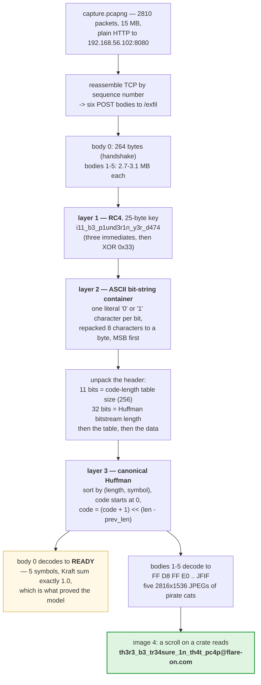

**Archive:** `5-catthief.7z` (password `flare`), containing `catthief.exe` and `capture.pcapng` · **Flag:** `th3r3_b3_tr34sure_1n_th4t_pc4p@flare-on.com`

Flare-On is the FLARE team's yearly reverse-engineering contest: each challenge hides a flag, a string
ending in `@flare-on.com`, and you find it by taking the program apart.

This one is a Rust exfiltration tool (a program that copies data off a machine to someone else's server)
plus a 15 MB packet capture, a recording of the network traffic while it ran. The tool steals cat pictures
and uploads them to a listener in HTTP POST requests. The flag is written on a
scroll in one of the pictures, so the whole challenge is really one task: reverse
the wire format well enough to get the images back out of the capture.

Three layers. RC4, a stream cipher, then a container format I hadn't seen before and haven't seen
since, then canonical Huffman, a compression scheme that gives common bytes short bit codes. The middle
one is the point of the challenge.

## Tools I used

Mostly packet tools and a disassembler, which turns machine code back into readable assembly:

| Tool | What I used it for |
|---|---|
| `tshark` / `scapy` | first pass over the capture; then I wrote my own TCP reassembler |
| `python3` | reassembly, RC4, the bit-string unpacker, and the first Huffman decoder |
| `C` (`clang -O2`) | the *second* Huffman decoder, after the Python one appeared to hang |
| `radare2` + `capstone` | reading `catthief.exe`; stripped Rust, so this was the slow part |
| `r2ghidra` (Ghidra's decompiler inside `radare2`) | pseudocode for the RC4 pair, `push_bits` and the Huffman tree walk |
| `strings` | finding the `src\compress.rs` panic path that cracked the binary open |
| `pillow` | cropping the flag region out of the recovered JPEG |

## The binary

`catthief.exe` is written in Rust and links the `ureq` 2.12.1 HTTP client, `rustls` (TLS),
`base64`, `flate2` (deflate compression) and `url`. The target sits in plain text right next to a `READY` marker and a source
path:

```
READYhttp://192.168.56.102:8080/exfilERRORsrc\compress.rs
```

Plain **HTTP**, despite `rustls` being linked in. Everything is in the capture in
the clear, which is the only reason this challenge is solvable. It's also a
decent joke about malware authors who link TLS and then don't use it.

`flate2` is linked too, and does nothing relevant. I checked, because "oh it's
just deflate" was my first and wrong theory about the payload.

### Navigating stripped Rust

Stripped Rust (a binary with its function names removed) is miserable to read: no symbols, heavy inlining, iterator chains
expanded into loops you won't recognize. But it hands you one good hook for free.

Every panic site, a place where Rust aborts on an error such as an out-of-range index, carries a
`core::panic::Location` struct, which is a pointer to
the source file name plus a line and column. So:

1. Find the `src\compress.rs` string.
2. Find the pointers to it. Those are `Location` structs.
3. Find the code that references *those structs*.

That drops you straight into the compression routines, with line numbers
attached. There were three of them here and they bracketed exactly the functions
I needed.

## The capture

Reassembling TCP by sequence number (stitching the packets back into the original byte streams) gives six
POST bodies:

| Body | Size | Content |
|---|---|---|
| 0 | 264 B | handshake |
| 1–5 | 2.7–3.1 MB | five JPEGs |

Before decoding anything, the bodies told me how they were encrypted. All six
start with the same bytes and stay nearly identical for the first ~120 bytes.
Bodies 1–5 differ from each other in only a handful of bits. Body 0 differs from
them by about **one bit in almost every byte**.

A stream cipher XORs every byte of the message with a byte from a keystream generated from the key.
Encrypt two messages with the same key and they get the same keystream, so wherever the plaintexts match,
the ciphertexts match too.

That is textbook **keystream reuse**: a single key, applied to plaintexts that
share a long prefix. A stream cipher, one fixed key, no nonce. Which meant I was
looking for RC4 or similar before I'd read a single instruction.

## Layer 1: RC4

RC4 has two halves: a key schedule (KSA) that shuffles a 256-byte table using the key, and an output loop
(PRGA) that keeps shuffling the table and emits one keystream byte per step. Two routines sit next to each
other in the binary:

- `0x1400052e2` fills an identity table, then loops `j += S[i] + key[i mod 25]`
  with a swap. The `div bl` with `bl = 25` and the `imul eax, eax, -0x19`
  alongside it are just the compiler computing `i mod 25` without a division.
- `0x140005281` is the output loop: `i++`, `j += S[i]`, swap,
  `k = S[(S[i]+S[j]) & 0xff]`, XOR into the buffer.

Textbook RC4 with a **25-byte key**. I read both rather than pattern-matching
them, then ran a known-answer test against a reference implementation (encrypting the same input with both and
comparing), because
by challenge 5 I had been burned by a "textbook" hash in challenge 4.

The Ghidra decompiler plugin in `radare2` (`r2ghidra`) shows both halves
plainly once it's pointed at the right addresses. The key schedule, with the
`i mod 25` exactly as the compiler wrote it:

```c
void fcn.1400052e2(int64_t arg1, int64_t arg2)       /* KSA: arg1 = state, arg2 = key */
{
    ...
    do {
        *(auStack_120 + iVar6) = iVar6;              /* S[i] = i */
        iVar6 = iVar6 + 1;
    } while (iVar6 != 0x100);
    uVar7 = 0;
    iVar2 = 0;
    while (iVar2 != 0x100) {
        ...
        cVar1 = acStack_220[iVar2];
        uVar7 = uVar7 + cVar1 + *(arg2 + (((iVar2 & 0xff) / 0x19) * -0x19 + iVar2 & 0xff));
        acStack_220[iVar2] = acStack_220[uVar7];     /* swap S[i], S[j] */
        iVar2 = iVar2 + 1;
        acStack_220[uVar7] = cVar1;
        ...
    }
    ...
    *(arg1 + 0x100) = 0;                             /* i = j = 0 */
}
```

`((i & 0xff) / 0x19) * -0x19 + i` is `i - 25 * (i / 25)`, which is `i % 25`. The
`...` lines are a 256-byte copy between two stack buffers that the compiler left
around every swap and that do nothing. The output loop is short enough to quote
whole:

```c
void fcn.140005281(int64_t arg1, int64_t arg2, int64_t arg3)  /* PRGA: state, buf, len */
{
    cVar1 = *(arg1 + 0x100);                         /* i */
    uVar3 = *(arg1 + 0x101);                         /* j */
    for (iVar4 = 0; arg3 != iVar4; iVar4 = iVar4 + 1) {
        uVar5 = cVar1 + 1 + iVar4;
        *(arg1 + 0x100) = uVar5;
        uVar6 = uVar5 & 0xff;
        cVar2 = *(arg1 + uVar6);
        uVar3 = uVar3 + cVar2;
        *(arg1 + 0x101) = uVar3;
        *(arg1 + uVar6) = *(arg1 + uVar3);
        *(arg1 + uVar3) = cVar2;
        *(arg2 + iVar4) = *(arg2 + iVar4) ^ *(arg1 + cVar2 + *(arg1 + uVar6));
    }
}
```

No modification anywhere: `i` and `j` live at `state+0x100` and `state+0x101`,
and the keystream byte is `S[S[i] + S[j]]`. After challenge 4 I wanted to see
that, not assume it.


The key is assembled from three immediates and then unmasked:

```asm
movups xmmword [rbp+0x9f7], xmm8      ; 16 bytes loaded from 0x1400c9010
movabs rax, 0x407576c41004a6c         ; 8 more
mov    qword [rbp+0xa07], rax
mov    byte  [rbp+0xa0f], 7           ; 1 more  -> 25 total
loop:
xor    byte [rbp+rax+0x9f7], 0x33     ; XOR all 25 bytes with 0x33
```

```
i11_b3_p1und3r1n_y3r_d474        ("I'll be plundering your data")
```

Splitting a key across a 16-byte SSE register load, an 8-byte immediate and a single
`mov byte` is a nice touch. No 25-byte run of anything appears in the file, so
there's nothing for an entropy scan or a string search to catch.

## Layer 2: the thing I'd never seen before

This is the part that makes the challenge.

Two helper functions build the message:

```asm
; 0x1400053fe   push_bits(vec, value, nbits)
bt     rdi, rsi          ; take bit n of value
setae  bpl               ; bpl = NOT bit
xor    bpl, 0x31         ; -> '1' (0x31) if set, '0' (0x30) if clear
mov    byte [rax+rcx], bpl

; 0x140005457   push_bytes_as_bits(vec, ptr, len)
; just calls push_bits(byte, 8) for every byte
```


The decompiler turns that routine into a single line, and the `'0'`/`'1'` trick
is easier to see there than in the assembly:

```c
void fcn.1400053fe(int64_t arg1, int64_t arg2, int64_t arg3)   /* push_bits(vec, value, nbits) */
{
    while (arg3 = arg3 - 1, arg3 != 0xffffffffffffffff) {
        iVar1 = *(arg1 + 0x10);                     /* vec.len */
        func_0x00014000f547(arg1, 1);               /* vec.reserve(1) */
        *(*(arg1 + 8) + *(arg1 + 0x10)) = (arg2 >> (arg3 & 0x3fU) & 1) == 0 ^ 0x31;
        *(arg1 + 0x10) = iVar1 + 1;
    }
}
```

`(bit == 0) ^ 0x31` is `0x30` for a clear bit and `0x31` for a set one, written
from the most significant bit down. The comments are mine; the `+0x8`/`+0x10`
offsets are a Rust `Vec<u8>`'s pointer and length.

Read that `xor bpl, 0x31` again. The message is assembled as a **string of
literal ASCII `'0'` and `'1'` characters**, one character per bit. A three
megabyte JPEG becomes a twenty-four megabyte text file of zeros and ones, in
memory, as an intermediate representation.

The layout:

```asm
push_bits(out, len1, 11)          ; 11 bits: size of the code-length table
push_bits(out, len2, 32)          ; 32 bits: size of the Huffman bitstream
push_bytes_as_bits(out, table, len1)
push_bytes_as_bits(out, data,  len2)
```

and then a final loop walks that character string and packs it back down to real
bits, eight characters per byte, MSB first:

```asm
cmp  eax, 0x31          ; is this character '1' ?
sete bl
or   bl, cl             ; bl = (bl << 1) | bit
inc  edi
cmp  edi, 8
jne  loop               ; emit a byte every 8 characters
```

It is completely pointless and it works perfectly. There's no obfuscation value
in it, since the output is identical to just writing the bits. But it does mean
that if you try to read the serializer as "pack a bit field," nothing lines up,
because there's a whole ASCII round-trip sitting in the middle.

Parsing is the mirror: expand the body to a bit string, read an 11-bit length,
then a 32-bit length, then the two arrays.

That 11-bit field is a nice detail by itself. The table is always 256 bytes,
which needs 9 bits. So 11 is both arbitrary and *just* wrong enough that if you
guess a byte-aligned header you get garbage with no clue why.

## Layer 3: canonical Huffman

Huffman coding builds a binary tree with frequent bytes near the root; a byte's code is its path from the
root, so its code length is its depth. "Canonical" means only those lengths are stored, and both sides
rebuild the codes from them by a fixed rule.

`0x1400053ab` is a recursive tree walk that writes one code length per symbol
into a 256-entry table, incrementing depth on each descent. The codes are
canonical: symbols sorted by `(length, symbol)`, code starts at zero,
`code = (code + 1) << (len - prev_len)` at each step.

The tree walk at `0x1400053ab` decompiles to a recursion that only ever
descends the left child and loops down the right, which is the compiler turning
one of the two recursive calls into a loop:

```c
void fcn.1400053ab(int64_t node, int64_t depth, int64_t lengths)
{
    depth = depth & 0xffffffff;
    while (*node != 0) {                            /* internal node */
        depth = CONCAT71(depth >> 8, depth + 1);    /* depth + 1, as a byte */
        fcn.1400053ab(*node, depth, lengths);       /* left child */
        node = *(node + 8);                         /* right child: iterate */
    }
    uVar2 = *(node + 8);                            /* leaf: its symbol */
    if (uVar2 < *(lengths + 0x10)) {
        *(*(lengths + 8) + uVar2) = depth;          /* lengths[symbol] = depth */
        return;
    }
    func_0x0001400c3d29(uVar2, *(lengths + 0x10), 0x1400c91a0);  /* bounds-check panic */
}
```

That last call is the panic path, and its third argument, `0x1400c91a0`, is one
of the `core::panic::Location` structs: a pointer to `src\compress.rs`, length
15, line 79, column 20. The parameter names and comments are mine.


The handshake is what proved the model, and it's worth walking through because
five symbols do an enormous amount of work.

Body 0's code-length table has exactly five non-zero entries:

| Symbol | Length |
|---|---|
| `D` (68) | 2 |
| `R` (82) | 2 |
| `Y` (89) | 2 |
| `A` (65) | 3 |
| `E` (69) | 3 |

Check the Kraft sum (for a complete prefix code, `2^-length` over all symbols must add up to exactly 1):
`2⁻² × 3 + 2⁻³ × 2 = 0.75 + 0.25 = 1.0` **exactly**. A
complete, valid prefix code. Canonical assignment gives

```
D = 00    R = 01    Y = 10    A = 110    E = 111
```

and encoding `READY` gives `01 111 110 00 10`, which packs to `7E 20`: byte for
byte the two data bytes in that message.

Five symbols, two bytes, and it confirms the container format, the bit order,
the canonical ordering, *and* the tree construction in one shot. Then the five
large bodies decoded to `FF D8 FF E0 ... JFIF` and I knew I was done.

## The solve

```python
KEY = b'i11_b3_p1und3r1n_y3r_d474'

body  = rc4(KEY, http_post_body)
bits  = ''.join(f"{c:08b}" for c in body)
len1  = int(bits[0:11], 2)                       # 256
len2  = int(bits[11:43], 2)
table = bits_to_bytes(bits[43 : 43 + 8*len1])
data  = bits_to_bytes(bits[43 + 8*len1 : 43 + 8*len1 + 8*len2])
jpeg  = canonical_huffman_decode(table, data)
```

Five 2816 × 1536 JPEGs of pirate cats:


<details markdown="1">
<summary>Mermaid source</summary>



</details>

The fourth image has a scroll lying on a crate:


## The decoder that "hung"

My first Huffman decoder was Python, and it appeared to hang. Not slow. *Hang*.
I let it run for several minutes on a 3 MB payload, killed it, added
progress printing, and watched it decode about forty thousand symbols and then
grind to a visible crawl.

My first instinct was that the tree was wrong and I was in an infinite loop. It
wasn't. The bug was one missing line:

```python
acc = (acc << 8) | byte
n  += 8
...
n -= code_len
acc &= (1 << n) - 1      # <-- this line was missing
```

Without the mask the accumulator never dropped the bits it had already consumed.
It just kept growing. By the end of a 3 MB payload it would have been a
24-million-bit integer, and every `<<` and `|` on it copies the whole thing. The
algorithm was right; the cost per symbol was growing with the number of symbols
already decoded, so the whole decode was quadratic.

The tell I should have read faster is that it got slower *smoothly*, over time.
An infinite loop doesn't do that. Neither does a wrong tree. An accumulator
nobody is trimming does exactly that, and it's worth having the shape in your
head, because the instinct when a bit-loop stalls is always to go re-check the
algorithm.

I rewrote it in C anyway. At 3 MB × 5 images even a correct Python bit-loop is
unpleasant; the C version finished all five in a couple of seconds.

**Flag:** `th3r3_b3_tr34sure_1n_th4t_pc4p@flare-on.com`
