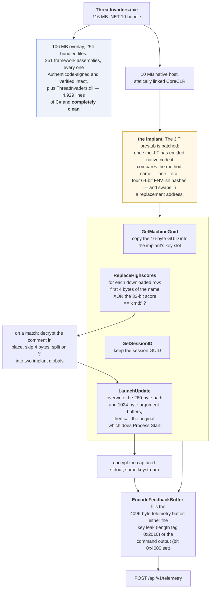
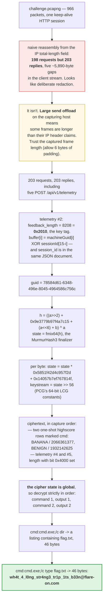

**Archive:** `6-ThreatInvaders.7z` (password `flare`), containing `ThreatInvaders.exe` and `challenge.pcapng` · **Flag:** `wh4t_4_l0ng_str4ng3_tr1p_1ts_b33n@flare-on.com`

A 116 MB Space Invaders clone and a packet capture of it talking to a highscore
server. Here is the shape of this challenge in one sentence: **the managed game
is entirely clean, and proving that is most of the work.**

Every bundled framework assembly is a genuine signed Microsoft build. The game's
own 4,929 lines of C# contain three separate things that look exactly like the
payload and aren't. The actual implant is in the **native host**: the .NET
single-file launcher has been patched to hook five managed methods at JIT time.

And then everything you need is in the capture, so nothing has to be run.

## Tools I used

| Tool | What I used it for |
|---|---|
| `python3` | a ~50-line single-file-bundle extractor, a TCP reassembler, and the final solver |
| `ilspycmd` (ILSpy) | decompiling `ThreatInvaders.dll` to C# |
| `dotnet` 10 | because `ilspycmd` needs `DOTNET_ROOT` pointed at a real runtime on macOS |
| `radare2` + `capstone` | the 10 MB native host, which is where the challenge actually lives |
| `r2ghidra` (Ghidra's decompiler inside `radare2`) | pseudocode for the implant's keystream routine |
| `strings` + `grep` | the single grep that cracked it open (see below) |
| a hand-written Authenticode verifier | checking all 251 bundled assemblies in one pass |
| `scapy` (for a first look), then my own parser | the pcapng |

## Unpacking the bundle

`ThreatInvaders.exe` is a .NET 10 self-contained single-file bundle: a 10 MB
native host followed by a 106 MB overlay. The bundle header is located from a
fixed 32-byte signature:

```
8b 12 02 b9 6a 61 20 38 72 7b 93 02 14 d7 a0 32
13 f5 b9 e6 ef ae 33 18 ee 3b 2d ce 24 b3 6a ae
```

with the header offset stored in the eight bytes immediately **before** it. The
manifest lists 254 entries, each `int64 offset, int64 size, int64
compressedSize, byte type, 7-bit-length-prefixed path`.

Decompiling the one interesting assembly needs the runtime pointed at explicitly
on macOS, which is the step that trips people up:

```console
$ export DOTNET_ROOT=/opt/homebrew/Cellar/dotnet/10.0.105/libexec
$ ilspycmd -o src -p ThreatInvaders.dll
```

That gives 4,929 lines across `SpaceInvaders`, `SpaceInvaders.Core`,
`SpaceInvaders.Game` and `SpaceInvaders.Scores`.

## Everything managed is clean, and it is maddening

I read the whole decompilation. Nothing in it is malicious. But four things
*look* like they are, and three of them are deliberately placed:

**`HttpRemoteScoreClient`** speaks plain HTTP to `http://threatinvaders.domain`
with an API key in a header. No crypto anywhere. Suspicious for a game, normal
for a CTF.

**`HighscoreStruct`** has a native-looking layout: an `InlineArray(20)` name
buffer and a raw `Comment` pointer into a manually allocated arena. It is
*screaming* "buffer overflow." Every bound is checked correctly.

**`TelemetryReporter`** base64-encodes a fixed 4,096-byte buffer regardless of
how short the actual feedback is. That's the textbook shape of an
uninitialised-memory leak, Heartbleed-style. Except this is managed code, where
arrays are zero-filled on allocation, so it leaks precisely nothing. (It becomes relevant
later, but not for that reason.)

**`UpdateLauncher`** carries a base64 blob that decodes to:

```
--install-dir Wouldn't_it_be_nice_if_this_was_the_real_flag@no-flare.com
--cwd But_sadly_it_isn't
```

An explicit troll, and I appreciated it.

Then there were the 251 bundled framework assemblies, which is where a
trojanized DLL would be an excellent place to hide. Rather than eyeball them I
wrote an Authenticode check: recompute each PE hash (skipping the checksum
field, the security data-directory entry, and the certificate table) and confirm
the result appears inside the signature blob.

**All 251 intact.** The only unsigned file in the bundle is the game itself.

So the payload is not in any assembly. Which is the point at which the challenge
actually starts.

## The grep that cracked it

I ran `strings` over the native host looking for anything that didn't belong in
a stock CoreCLR, and found this:

```
TieredCompilationManager::DoBackgroundWork: ...
ReplaceHighscores
.NET Tiered Compilation Worker
```

`ReplaceHighscores` is a method in `ThreatInvaders.dll`. It has been dropped into
padding between two stock CoreCLR format strings in `.rdata`.

A statically-linked CoreCLR has **no reason whatsoever** to contain the name of a
method belonging to the application it is hosting. The runtime resolves methods
through metadata; it never hardcodes application identifiers. That one string is
the whole tell, and in hindsight it's the first thing I should have looked for:
grep the native parts for identifiers that only exist in the managed parts.

## The hook machinery

One code path references that string, and it's inside the tiered-compilation
path:

```asm
cmp  qword ptr [rip+...], r15      ; is the global slot still empty?
jne  skip
mov  rcx, rbp                      ; rbp = MethodDesc
call get_method_name
mov  rcx, rax
lea  rdx, [rip+...]                ; "ReplaceHighscores"
call strcmp
test eax, eax
jne  skip
mov  qword ptr [rip+...], rbp      ; remember this MethodDesc
```


With addresses, as `radare2` lists it. The function is `0x14016c050`, and it is
called from three places in the runtime:

```text
            ; CALL XREF from fcn.14016e040 @ 0x14016e1e3(x)
            ; CALL XREF from fcn.14016ea50 @ 0x14016ec9b(x)
            ; CALL XREF from fcn.14016f0b0 @ 0x14016f299(x)
/ 514: fcn.14016c050 (int64_t arg1, uint64_t arg2, int64_t arg3);
|  0x14016c073  mov rax, qword [rdx + 8]
|  0x14016c077  cmp dword [rdx], 1
|  0x14016c07a  cmovne rax, rdx
|  0x14016c07e  mov rbp, qword [rax + 8]          ; the MethodDesc
|  0x14016c082  cmp qword [0x1407fe5a0], r15      ; r15 = 0: slot still empty?
|  0x14016c089  jne 0x14016c0ae
|  0x14016c08b  mov rcx, rbp
|  0x14016c08e  call fcn.1400c17e0                ; get the method's name
|  0x14016c093  mov rcx, rax
|  0x14016c096  lea rdx, str.ReplaceHighscores    ; 0x140755dd0
|  0x14016c09d  call qword [strcmp]
|  0x14016c0a3  test eax, eax
|  0x14016c0a5  jne 0x14016c0ae
|  0x14016c0a7  mov qword [0x1407fe5a0], rbp      ; remember this MethodDesc
|  0x14016c0ae  mov edi, 1
```

The comments are mine. The string at `0x140755dd0` has exactly one reference,
and this is it.

The other four hooks don't use a literal at all. They match a **64-bit hash** of
the name, which is why only one of the five showed up in `strings`. The hash is a
mutating-multiplier variant of FNV:

```python
MASK = 0x8f3a2c91d7b4e6a5
P    = 0xc53a1b7f2d9e4467
M0   = 0x5ca6e801706eaaac
K    = 0x2545f4914f6cdd1d

def h(s):
    b = s.encode()
    x = ((b[0] ^ MASK) * P) & M64
    m = M0
    for c in b[1:]:
        x = ((c ^ x) * m) & M64
        m = (m * K + 1) & M64      # the multiplier changes every round
    return x
```

Hashing every name in the assembly's metadata resolves all of them in one pass,
which is the trouble with name hashes in a closed system. The author gets
obscurity; you get a dictionary attack with a dictionary of size 5,000.

| Hash | Method |
|------|--------|
| `0x3f926793476b8710` | `GetMachineGuid` |
| `0xa3a845aec791499a` | `GetSessionID` |
| `0x5f6e18db1be45dc7` | `HasFeedback` |
| `0x6397c52d5293345e` | `EncodeFeedbackBuffer` |
| `0x6f8ff9636eae6c5a` | `LaunchUpdate` |
| `0x322131f288b022a7` | `ReplaceHighscores` |
| `0xce723a0a685e63e4` | `cmd:` |

The patch sits at the **tail of the prestub**, after the JIT has produced native
code. It saves the original code pointer in a global and substitutes the address
of a replacement, so the managed caller transparently lands in the implant. Each
replacement reaches the original through a small trampoline that shifts the
arguments back and jumps to the saved pointer.

Hooking at JIT time is a good trick. There's no IAT patch, no detour in the
managed code, no modified IL, and nothing for a managed-code integrity check to
catch. The IL on disk is pristine. The native code the JIT produced for it just
never gets called.


<details markdown="1">
<summary>Mermaid source</summary>



</details>

## What each hook does

**`GetMachineGuid`** calls the original and copies the resulting 16-byte GUID
into the implant's key slot. This is the **only key material in the entire
implant**. There is no embedded secret anywhere.

**`GetSessionID`** does the same for the session GUID.

**`ReplaceHighscores`** receives the freshly downloaded `HighscoreStruct[]`. It
checks the array stride and `FormatVersion`, then for every entry computes the
first four bytes of the player name XOR the 32-bit score, and hashes the result.
A match means `cmd:`. Working it out by hand for the two anomalous entries in
the capture:

```
"BANA" ^ 0x7B2A2C21 -> "cmd:"      (player BANANA, score 2066361377)
"BENI" ^ 0x732A2821 -> "cmd:"      (player BENIGN, score 1932142625)
```

I like this a lot as a C2 channel. The marker is the XOR of a player name and
their score, so both halves are innocuous on their own, the board renders
normally, and the server needs no side channel at all.

For a matching entry it decrypts the comment in place, skips four bytes, and
splits the rest on the first `;` into two implant globals.

**`LaunchUpdate`** is the managed updater launcher. The hook overwrites the
260-byte path buffer and the 1,024-byte argument buffer with the two stashed
halves, calls the original (which does `Process.Start` with
`RedirectStandardOutput`), then encrypts the captured stdout with the same cipher
and stores it.

And this is where those earlier "clean" findings come back: the version endpoint
always answers `{"latest":"1.0.0.1","message":""}`, which is newer than the
assembly's `1.0.0.0`, so `LaunchUpdate` is reached on **every** sync. And
`Program.Main` hard-codes `headlessUpdate = true`, so there is never a prompt.
Both of those read as ordinary application logic in the C#. They are the delivery
mechanism.

**`EncodeFeedbackBuffer`** builds the telemetry `feedback_b64` field. Depending
on which implant flag is set it writes either the key leak or the stored command
output into that 4,096-byte buffer (the one that looked like a memory-disclosure
bug) and reports a length that doubles as a tag: `0x2010` for the key leak, and
the real length with bit `0x4000` set for command output.

So the "fake vulnerability" in the managed code is the exfil channel after all,
just not in the way it was advertising.

## The cipher

One routine, used for both decrypting commands and encrypting stdout, with state
that **persists across calls**:

```python
# seeded once, from the MachineGuid
a = int.from_bytes(guid[:8],  'little')
b = int.from_bytes(guid[8:], 'little')
h = (((a >> 2) + 0x9e3779b97f4a7c15 + (a << 6) + b) & M64) ^ a
state = fmix64(h)          # the MurmurHash3 finalizer

# one byte at a time
state = (state * 0x5851f42d4c957f2d + 0x14057b7ef767814f) & M64
keystream_byte = state >> 56
```

Those are recognizable constants if you've seen them before: `0x9e3779b97f4a7c15`
is the 64-bit golden ratio (it's `boost::hash_combine`), `fmix64` is
MurmurHash3's finalizer, and `0x5851f42d4c957f2d` / `0x14057b7ef767814f` are
**PCG**'s 64-bit LCG constants. Taking only the top byte of the state is PCG-ish
too, since it's the high bits that are well-mixed in an LCG.

That is a paraphrase in Python. Here is the routine itself, at `0x1400c65e0`,
from the Ghidra decompiler plugin in `radare2`:

```c
void fcn.1400c65e0(int64_t buf, int64_t len)
{
    if (*0x1407ffa20 == 0) {                         /* first call only: seed */
        fcn.140633d70(&uStackX_18, 0x1407ffa30, 8);  /* a = guid[0:8]  */
        fcn.140633d70(&iStackX_20, 0x1407ffa38, 8);  /* b = guid[8:16] */
        uStackX_18 = (uStackX_18 >> 2) + 0x9e3779b97f4a7c15 + uStackX_18 * 0x40 + iStackX_20
                     ^ uStackX_18;
        uVar1 = (uStackX_18 >> 0x21 ^ uStackX_18) * -0xae502812aa7333;
        *0x1407ffa20 = (uVar1 >> 0x1d ^ uVar1) * -0x3b314601e57a13ad;
        *0x1407ffa20 = *0x1407ffa20 >> 0x20 ^ *0x1407ffa20;
    }
    uVar1 = 0;
    if (len != 0) {
        do {
            *0x1407ffa20 = *0x1407ffa20 * 0x5851f42d4c957f2d + 0x14057b7ef767814f;
            *(buf + uVar1) = *(buf + uVar1) ^ *0x1407ffa20 >> 0x38;
            uVar2 = uVar1 + 1;
            uVar1 = uVar2;
        } while (uVar2 < len);
    }
}
```

The two negative multipliers are how the decompiler prints `fmix64`'s constants
as signed values: `-0xae502812aa7333` is `0xff51afd7ed558ccd` and
`-0x3b314601e57a13ad` is `0xc4ceb9fe1a85ec53`, which is what the disassembly has
in its `movabs` immediates. The state lives in one global, `0x1407ffa20`, and is
only seeded while it is zero. That single `if` is the whole reason the
keystream runs continuously across every call. The routine has two callers, at
`0x1400c686f` and `0x1400c6b4b`, which fits one decrypt path and one encrypt
path through the same state.


The critical property for solving: the state is **global**, so the keystream runs
continuously through command 1, then output 1, then command 2, then output 2. You
must decrypt them in that order or everything after the first mistake is noise.

It's worth seeing what the failure looks like, because it is very easy to walk
into. The two commands are the obvious pair to grab first, and the 530-byte
output between them is easy to treat as a separate problem:

```
correct order        cmd1 = b'cmd:cmd.exe;/c dir'
                     cmd2 = b'cmd:cmd.exe;/c type flag.txt'

both commands first  cmd1 = b'cmd:cmd.exe;/c dir'
                     cmd2 = b'\x12^d\x80\x9e\xb3\xfd\x7f\xfa\xf6\x9e\xf2...'
```

Skip output 1 and the keystream is 530 bytes out of phase by the time it reaches
command 2. That shape, **first item perfect and everything after it noise**, is
worth recognizing on sight: it says your key is right and your *ordering* is
wrong. A wrong key gives you garbage from byte zero.

## Reading the capture


<details markdown="1">
<summary>Mermaid source</summary>



</details>

### The trap

The capture is a single keep-alive HTTP session, 966 packets. My first
reassembly computed the TCP payload length from the IP total-length field, which
is the textbook way, and produced **198 requests but 203 responses**, with five
gaps of roughly 5,890 bytes each in the client stream.

Five missing requests. Five telemetry uploads. That is *exactly* what a
deliberately redacted capture would look like, and I spent a while building a
theory in which the challenge wanted me to reconstruct the uploads from the
server's responses.

The capture is complete. It was taken on a Windows host with **large send
offload** active, so a handful of frames are up to 4,150 bytes long while their
IP total-length field describes only part of the frame. The NIC was going to
segment them, so the stack never filled in a correct length. My reassembler
trusted the header and threw away the rest of every oversized frame.

The fix is three lines: trust the captured frame length when it exceeds what the
IP header claims, while still allowing the usual six bytes of Ethernet padding on
short frames.

```python
end = 14 + ip_total if (len(frame) - 14 - ip_total) <= 6 else len(frame)
payload = frame[tcp_header_end:end]
```

With that, all 203 requests appear, including the five `POST /api/v1/telemetry`.

**When reassembled request and response counts disagree, suspect the reassembler
before you conclude the capture is incomplete.** Captures taken on an endpoint
rather than on the wire routinely contain frames that violate what the IP header
says, because offload means the final packet never existed in that form in
software.

### Recovering the key

The second telemetry POST reports `feedback_length` of `8208` = `0x2010`, the
key-leak tag. Its buffer begins with sixteen bytes of

```
machineGuid[i] XOR sessionId[15 - i]
```

and the session GUID is sitting in the **same JSON document**, as `session_id`.
So the implant exfiltrates its own key XORed with a value it transmits in
cleartext two fields away.

```python
exfil = base64.b64decode(t['feedback_b64'])[:16]
sid   = uuid.UUID(t['session_id']).bytes_le
guid  = bytes(a ^ b for a, b in zip(exfil, sid[::-1]))
# -> 78584d61-6348-496e-8045-4964586c756c
```

(Note the `[::-1]`: the XOR is against the session ID **reversed**. Get that
wrong and you still get sixteen plausible-looking bytes out, just not a GUID that
reproduces the keystream.)

### The two commands

The injected board entries appear in exactly one highscore response each and then
vanish, which is what one-shot C2 delivery looks like. Decrypting in capture
order:

```
command 1: cmd:cmd.exe;/c dir
command 2: cmd:cmd.exe;/c type flag.txt
```

And the outputs, from telemetry POSTs 4 and 5:


530 bytes and then 46 bytes. The `dir` listing even leaks the author's build
path, `Z:\CTFs\FlareOn\SpaceInvaders\space-invaders\src\SpaceInvaders\bin\Release\net10.0-windows\publish\win-x64`,
which is exactly the kind of accidental detail you find in real incident data.

## The solver

`solve6.py` reads `challenge.pcapng` and nothing else. It's 105 lines, and the
core is this:

```python
def fmix64(x):
    x ^= x >> 33; x = (x * 0xff51afd7ed558ccd) & M64
    x ^= x >> 29; x = (x * 0xc4ceb9fe1a85ec53) & M64
    return (x ^ (x >> 32)) & M64

class Keystream:
    def __init__(self, guid16):
        a = int.from_bytes(guid16[:8], 'little')
        b = int.from_bytes(guid16[8:], 'little')
        h = (((a >> 2) + 0x9e3779b97f4a7c15 + ((a << 6) & M64) + b) & M64) ^ a
        self.st = fmix64(h)
    def xor(self, data):
        out = bytearray()
        for c in data:
            self.st = (self.st * 0x5851f42d4c957f2d + 0x14057b7ef767814f) & M64
            out.append(c ^ (self.st >> 56))
        return bytes(out)
```

Commands are located by the `cmd:` marker, the key by the `0x2010` tag, the
outputs by the `0x4000` bit, and then everything goes through **one** keystream
object in capture order.

The full solver is in the [flare-on-13 repository](https://github.com/taogoldi/flare-on-13): [`solve6.py`](https://github.com/taogoldi/flare-on-13/blob/main/solvers/solve6.py).

## What I'd take away

Three layers each look like the answer and are not: the fake uninitialised-memory
leak, the troll flag in `UpdateLauncher`, and the deliberately native-looking
`HighscoreStruct` arena. Confirming all three are benign isn't wasted work; it's
what forces you out of the managed code and into the host binary, which is the
only place left.

Two checks did almost all of the real work:

- Verifying Authenticode on all 251 bundled assemblies ruled out a trojanized
  framework DLL in a single pass, instead of 251 manual looks.
- Grepping the native host for **managed** identifiers found the implant
  immediately.

That second one generalises. In any mixed-language artifact (a .NET bundle, a
Java fat jar with JNI, an Electron app, a Python app with native extensions),
look for names that have crossed a layer boundary they had no business crossing.
Strings that belong to one layer and appear in another are almost always
somebody's hook table.

**Flag:** `wh4t_4_l0ng_str4ng3_tr1p_1ts_b33n@flare-on.com`
