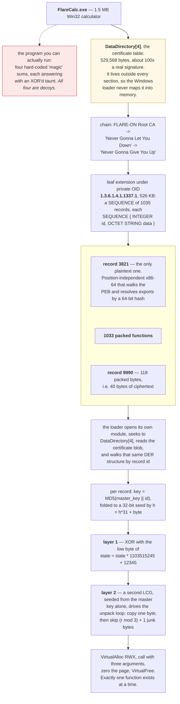

**Archive:** `7-FlareCalc.7z` (password `flare`), containing `FlareCalc.exe` · **Flag:** `t3mplat3s_asn_and_j1t_0h_my@flare-on.com`

Flare-On is the FLARE team's yearly reverse-engineering contest: each challenge hides a flag, a string
ending in `@flare-on.com`, and you find it by taking the program apart.

This one is a 1.5 MB Windows calculator. The calculator is bait. The actual challenge is a
517 KB implant smuggled **inside the executable's Authenticode signature**, the code-signing block Windows
reads to show who published a program. There it is never mapped into memory and never touched by the
program you can run.

Inside that signature sit 1,035 records: one plaintext shellcode loader (shellcode is raw machine code
built to run without a normal program around it), one 40-byte ciphertext, and 1,033 tiny functions that are individually encrypted,
padded with junk bytes, and executed one at a time from a scratch page that gets
wiped afterward. Together they're a state machine, a program that moves from one state to the next on each input byte,
and its final state is the key to the flag.

The useful part of this one, for me, was learning to stop tuning a heuristic and
go recover the generator sitting behind it. Accepting that took longer than doing
it.

## Tools I used

Python for parsing, a disassembler (which turns machine code into readable assembly) and an emulator for
running the small functions without Windows:

| Tool | What I used it for |
|---|---|
| `pefile` | reaching `DataDirectory[4]` and pulling out the certificate table |
| `python3` + hand-written DER walker | 1,035 records under a private OID; `asn1crypto` choked on the size, mine didn't |
| `openssl asn1parse` | sanity-checking my DER reading against something I didn't write |
| `capstone` | disassembling the shellcode loader and the 1,034 unpacked functions |
| `r2ghidra` (Ghidra's decompiler inside `radare2`) | pseudocode for unpacked records 52090 and 4485, to check my C against |
| **Unicorn** | emulating the tiny functions, hooking `cpuid` and short-circuiting a million-iteration delay loop |
| `python3` (again) | an LCG phase-voting attack, a 24-bit brute force, and a depth-first search over the state machine |
| `cc` (clang) | compiling the C reconstruction below and diffing its output against the solver |

Everything here is static or emulated. `FlareCalc.exe` is a Windows binary and I
never ran it; it would not have helped if I had, because the implant and the
program that ships it never meet.

## The calculator is bait

`FlareCalc.exe` is an obfuscated but ordinary Win32 calculator: digits, four
arithmetic operators, AND/OR/XOR/NOT, and a history line. Its `=` handler
compares the typed expression against four hard-coded strings and answers each
with an XOR-encrypted taunt, keyed by the expression itself:

| Expression | Answer |
|------------|--------|
| `525+193` | `FLAG{NICE_TRY}` |
| `742*186` | `ACCESS DENIED` |
| `931-482` | `KEY_EXPIRED` |
| `843*952` | spawns a thread that sends a rickroll to its own window |

The rickroll goes through `WM_COPYDATA` to the window class
`Flare-OnCalculatorClass`, with the lyric XOR-encrypted under the key `843*952`.
Somebody had fun.

Nothing else in the binary is malicious. It imports no `ReadFile`, so it cannot
read its own file. The certificate table lives outside every section, so the
loader never maps it. **The implant and the program that ships it never meet.**

That last sentence is the deliberate dead end, and it is a good one. The
implant's loader, which can only be found *inside* the signature, reads its own
module's certificate table. So the packed functions are only reachable through a
loader that the shipped program never invokes. If you spend your time hunting for
the code path that calls the implant, you will not find one, because there isn't
one.

Accepting that the executable is pure bait, rather than looking for the trigger,
is most of the challenge.

## Finding the payload

The certificate table is **529,568 bytes**. A real Authenticode signature is
around five. That is the entire detection step; everything after it is work.

The chain is a joke in itself: **FLARE-ON Root CA** issues to **Never Gonna Let
You Down**, which issues to **Never Gonna Give You Up**, also styled the
*Flare-On Code Signing Authority*.

Certificates are stored in DER, a compact binary encoding, and every field is named by an OID (object
identifier), a dotted number. The leaf certificate carries a 526 KB extension under the private OID
**1.3.6.1.4.1.1337.1**. Its value is a `SEQUENCE` of 1,035 entries, each a
`SEQUENCE { INTEGER id, OCTET STRING data }`. The record ids are 16-bit values
scattered between 49 and 65,469. Not sequential, which matters later.

Exactly one record, id **3821**, is plain x86-64: position-independent shellcode
that walks the PEB (the process's own list of loaded modules) to find module bases, and resolves the
Windows functions it needs by a 64-bit hash of their names instead of storing the names.


<details markdown="1">
<summary>Mermaid source</summary>



</details>

## Resolving the shellcode's imports

The hash is a rotate-and-add over the uppercased name:

```python
h = 0
for ch in name:
    c = ord(ch) - 0x20 if 'a' <= ch <= 'z' else ord(ch)
    h = ((h << 7) | (h >> 57)) & M64
    h = (h + c) & M64
h &= 0x7FFFFFFFFFFFFFFF
```

There's a nice shortcut here. The rotate is a multiply by 128 modulo `2**64 - 1`,
so this is just **the name read as a base-128 number**. Names of nine characters
or fewer decode straight out of the hash. No dictionary, no searching, just
divide by 128 repeatedly and read off the characters. The longer ones fell to a
short word list.

The resolved set tells the entire story before I'd read a single unpacked
function:

- `GetModuleHandleW`, `GetModuleFileNameW`, `CreateFileW`, `SetFilePointer`,
  `ReadFile`: **it reads its own file**
- `VirtualAlloc`, `VirtualFree`, `RtlAllocateHeap`, `HeapFree`: a scratch page
- the `BCrypt*` family: MD5
- `socket`, `getaddrinfo`, `gethostname`, `inet_ntop`, `WSAIoctl`, `closesocket`:
  a command channel

Self-reading plus a scratch page plus MD5 plus a socket is a complete
architecture sketch. Import hashing is supposed to hide intent, and it does
hide it from `strings`, but once you can invert the hash it hands you more
structure than an import table would, because nobody bothers to pad an import-by-
hash list with decoys.

## How a record is packed

Two layers, both driven by the same classic LCG (linear congruential generator: multiply the state by one
constant, add another, repeat), `state = state * 1103515245 + 12345`.

**Layer 1: keystream XOR.** The key is `MD5(master_key || record_id)`, reduced
to a 32-bit seed by `h = h*31 + byte`, and each output byte is the low byte of
the next LCG state.

**Layer 2: junk interleaving.** A second LCG, seeded from the master key alone,
drives the unpack loop: copy one byte, draw `r`, skip `(r % 3) + 1` bytes,
repeat. The skipped bytes are the low bytes of that same generator, so the junk
is *generated* rather than random, and a packed record ends up roughly three
times the size of the code it hides.

The result is `VirtualAlloc`ed as `PAGE_EXECUTE_READWRITE`, called with three
arguments, then zeroed and freed. Only one function is ever decrypted at a time,
so there is no moment at which the payload exists in memory as a whole. Dumping
the process gets you one tiny function and a lot of nothing.

## Breaking it without the key

The master key is a string built at runtime as `"A-B-C"` from three 32-bit values
passed into the loader by whatever injected it. We never see them.

We also don't need them, because of one property of a power-of-two LCG: **the low
byte evolves entirely on its own.**

```
(state * 1103515245 + 12345) mod 256  ==  (low * 0x6D + 0x39) mod 256
```

The high bits never feed down into the low bits. That's the classic reason you
never use the low bits of `rand()`; here it's fatal. The map is a single
256-long cycle, so the XOR keystream of *any* record is one of only **256**
sequences, identified by its phase. The junk bytes come from the second
generator's low byte, which is also one of those 256 sequences.

Both generators advance exactly once per byte position, so for every packed
record:

```
at a junk position:  packed[p] = cycle[(a + p) % 256] ^ cycle[(b + p) % 256]
at a real position:  packed[p] = code_byte ^ cycle[(a + p) % 256]
```

Vote over all positions and `a` and `b` fall out. And because `b` is derived from
the master key alone, it is **the same for every record**: 243. That gave me a
free consistency check across all 1,035 decodes, which is the kind of thing worth
looking for early.

### The trap

Recovering the phases is not enough, and this is where the challenge took most of
my time.

The obvious reading of the junk layer is that a run of junk is however many
consecutive bytes match the generator. That reading is correct for about **99.6%
of bytes**. When a real code byte happens to equal the junk byte it would have
taken, the run looks one byte longer and the walk loses sync.

99.6% per byte sounds excellent. On records averaging a couple of hundred bytes
it means most records come out wrong.

And the failure mode is nasty, because the output still disassembles cleanly as
x86-64, still ends in `ret`, and still looks like a plausible stirring function.
Hundreds of candidate decodes satisfied every constraint I could think of. So I
started picking the one with the fewest anomalies, which is wrong often enough
that the state machine stalls three steps in with nothing at all to point at the
cause.

Refining the anomaly scoring was the mistake. The fix is to stop guessing run
lengths and recover the junk generator's **full 32-bit state**. The low byte is
already known, so only 24 bits remain. One record that decodes unambiguously
pins the skip sequence, and a few seconds of brute force gives a unique answer:

```
dejunk seed = 0x429057CE
```

With the full state the skip pattern is deterministic, and because the generator
restarts identically for every record it is also **global**: real bytes
always sit at the same offsets, in every record. Every record then decodes
exactly. 1,034 come out as clean x86-64 functions ending in `ret`; the odd one
out, id 9990, is 40 bytes of data.

When a decode is heuristic and the result is almost right, recover the
generator instead of tuning the heuristic. An "almost right" decode is not
nearly-solved. It's a different problem that happens to look similar, and no
amount of scoring closes the gap.

## The state machine

Each of the 1,034 functions follows the same template. It takes a byte in `rcx`
and a pointer to a 32-byte state in `rdx`, stirs four state bytes, burns a
million iterations of a loop whose sum is a constant that gets subtracted
straight back off, and returns a 32-bit value:

```asm
mov  al, byte ptr [rdx + 2]
add  al, byte ptr [rdx + 1]
xor  al, r8b                 ; the input byte
add  al, 0x1a
mov  byte ptr [rdx + 1], al
...
imul edx, eax, 0x1337
sub  eax, 0x6a4ae6e0         ; exactly cancels the delay loop
xor  ecx, 0x68925143
add  ecx, 0x976a05fa
xor  eax, ecx
ret
```

That delay loop is pure anti-emulation, code whose only job is to make running it in an emulator too slow
to be useful: a million iterations per function, 1,034 functions, 31 steps of search depth, times 256
candidate bytes. Under Unicorn, the CPU emulator I was running these functions in, that's unfinishable. Short-circuit the loop (the sum is a constant, and
the very next instruction subtracts it straight back off) and the whole search
takes seconds.

The loader stores the return value as the id of the next function to run. The
machine starts at id **52090** with the state zeroed, consumes one byte per step
from the socket, and finishes when the id reaches **4485**.

And this is what makes it solvable at all. The return is a full 32-bit value, but
only 1,035 of those `2**32` values name a real record. So at nearly every step
exactly **one** input byte keeps the machine alive; everything else returns an id
that doesn't exist. A depth-first search over the 256 possible bytes, preferring
printable ones, walks the whole chain in seconds:

```
FLAREON_ASN1_Labyrinth_Key_2026!
```

Thirty-one steps later the state holds:

```
670daa0ff05e7d85472eeb55a716a7b88d63019c27ee22ea447fd4fde87c013d
```


<details markdown="1">
<summary>Mermaid source</summary>



</details>

```mermaid
flowchart TD
    A["<b>the weakness</b>: in an LCG modulo a power of two,<br/>the low byte evolves entirely on its own —<br/>(s*1103515245 + 12345) mod 256 == (low*0x6D + 0x39) mod 256"]
    A --> B["that map is a single 256-long cycle, so every<br/>record's keystream is one of only 256 sequences,<br/>identified by its phase. The junk bytes are the<br/>other generator's low byte, from the same cycle."]
    B --> C["at junk positions: packed[p] = cycle[a+p] ^ cycle[b+p]<br/>at real positions: packed[p] = code ^ cycle[a+p]<br/>-> vote over all positions to recover a and b"]
    C --> D["b comes from the master key alone, so it is the<br/>same for every record: <b>243</b>. A free consistency<br/>check across all 1035 decodes."]
    D --> E["<b>but this still isn't exact.</b> When a real code byte<br/>happens to equal the junk byte it would take, a run of<br/>junk looks one byte longer and the walk loses sync —<br/>yielding clean, plausible, <b>wrong</b> x86-64."]
    E --> F["so recover the junk generator's <b>full 32-bit state</b>,<br/>not just its low byte. 24 bits left, one unambiguous<br/>record to check against, a few seconds of brute force:<br/><b>dejunk seed = 0x429057CE</b>"]
    F --> G["the generator restarts identically for every record,<br/>so the skip pattern is <b>global</b> — real bytes always sit<br/>at the same offsets. Every record now decodes exactly."]
    G --> H["1034 clean x86-64 functions, each ending in ret,<br/>plus record 9990, which is 40 bytes of data"]
    H --> I["each function takes a byte in rcx and a 32-byte state<br/>in rdx, stirs four state bytes, burns a million-iteration<br/>delay loop whose sum is subtracted straight back off,<br/>and returns <b>the id of the next function to run</b>"]
    I --> J["start at id 52090, state all zeros.<br/>Only 1035 of 2^32 returns name a real record, so at<br/>almost every step exactly one input byte keeps it alive."]
    J --> K["depth-first over the 256 bytes, printable first:<br/><b>FLAREON_ASN1_Labyrinth_Key_2026!</b> — 31 steps, id 4485"]
    K --> L["final state 670daa0f..e87c013d;<br/>XTEA key = second half XOR first half,<br/>as little-endian 32-bit words"]
    L --> M["XTEA, 32 rounds, delta 0x9E3779B9, big-endian blocks,<br/>over record 9990's 40 bytes:<br/><b>t3mplat3s_asn_and_j1t_0h_my@flare-on.com</b>"]
    style M fill:#dff5e1,stroke:#2f9e44,stroke-width:2px
    style E fill:#fde8e8,stroke:#d93025
    style A fill:#fff8e6,stroke:#c9a227
```

## The flag

Record 4485 is XTEA, a small and old block cipher. Its key is sixteen bytes: the second half of the final state
XORed with the first half, taken as little-endian 32-bit words. It runs 32 rounds
with the usual delta `0x9E3779B9`, on big-endian blocks, over the 40 bytes of
record 9990:

```
t3mplat3s_asn_and_j1t_0h_my@flare-on.com
```

Forty bytes exactly, and here's the detail I found most satisfying: record 9990
is 118 packed bytes, and 118 divided by three is 39, so the length confirms the
container was read correctly before I even look at the plaintext. Length
arithmetic that checks out is cheap evidence, and I've learned to look for it.

## The implant's logic in C

This isn't the author's source. It's my reconstruction from the disassembly,
rewritten as C so the moving parts are easier to read than in Python or raw
x86-64. The names are mine. I've left out the PEB walk, the import hashing and
the code that reads the certificate table, since those are covered above and
add nothing to the logic. Every piece below was compiled and checked against
`solve7.py` and the real records.

**Unpacking a record.** Both generators advance once per packed byte, junk or
not. That's the property the whole attack rests on, and it's easier to see here
than in the description:

```c
static uint32_t lcg(uint32_t *s)
{
    *s = *s * 1103515245u + 12345u;
    return *s;
}

/* xor_seed:  MD5(master_key || record id), folded with h = h*31 + byte
   junk_seed: derived from the master key alone; recovered as 0x429057CE */
size_t unpack_record(const uint8_t *in, size_t len,
                     uint32_t xor_seed, uint32_t junk_seed, uint8_t *out)
{
    uint32_t k = xor_seed, j = junk_seed;
    size_t n = 0, p = 0;

    while (p < len) {
        uint8_t  ks = (uint8_t)lcg(&k);     /* only the low byte is ever used */
        uint32_t r  = lcg(&j);
        out[n++] = in[p++] ^ ks;            /* one real byte */
        for (uint32_t skip = r % 3 + 1; skip && p < len; skip--, p++) {
            lcg(&k);                        /* junk: both generators still step */
            lcg(&j);
        }
    }
    return n;
}
```

Fed with seed `0x429057CE` and an XOR seed whose low byte matches the recovered
phase, this produces output identical to `solve7.py` for all 1,034 packed
records. The upper 24 bits of `xor_seed` never matter, which is the low-byte
weakness again, stated in code.

**The dispatch loop.** One function exists in memory at a time:

```c
typedef uint32_t (*fsm_fn)(uint8_t c, uint8_t *state, void *ctx);

uint8_t  state[32] = { 0 };
uint32_t id = 52090;

while (id != 4485) {
    uint8_t c = recv_byte(sock);                 /* one input byte per step */
    size_t  n = unpack_record(rec_data(id), rec_len(id),
                              xor_seed_for(id), junk_seed, scratch);

    void *page = VirtualAlloc(NULL, n, MEM_COMMIT | MEM_RESERVE,
                              PAGE_EXECUTE_READWRITE);
    memcpy(page, scratch, n);
    id = ((fsm_fn)page)(c, state, ctx);          /* return value = next record id */
    SecureZeroMemory(page, n);
    VirtualFree(page, 0, MEM_RELEASE);
}
/* record 4485 runs last and decrypts record 9990 with XTEA */
```

`recv_byte`, `rec_data` and the rest stand in for code I've skipped. An id that
doesn't name a record is a dead end, which is what made the depth-first search
work.

**One state-machine function.** Here is record 52090, the entry point,
translated instruction by instruction:

```c
static uint32_t rotl32(uint32_t x, int n) { return x << n | x >> (32 - n); }

uint32_t fsm_52090(uint8_t c, uint8_t *st, void *unused)
{
    uint8_t t = (uint8_t)(((st[1] + st[0]) ^ c) + 0x13);
    st[0]     = t;
    st[7]    ^= (uint8_t)(t + 0x5A);
    st[0x13] += st[7] ^ 0xA5;

    /* anti-emulation stall: sum of 0..999,999 mod 2^32 == 0x6A4AE6E0 */
    volatile uint32_t sum = 0;
    for (volatile uint32_t i = 0; i < 1000000; i++)
        sum += i;

    uint32_t a = rotl32((uint32_t)st[7] * 0x1337 - 0x55555556, 11);
    uint32_t b = rotl32((uint32_t)c * 0x1337 + 0x55555555, 5);
    return (sum - 0x6A4AE6E0) ^ a ^ b ^ 0x6B82E2BF;
}
```

In C the stall is obviously dead weight: `sum - 0x6A4AE6E0` is always zero. In
the binary it's a million iterations an emulator has to grind through, and the
`volatile` is roughly what you'd need to stop a compiler from folding it away.
Compiled and run over all 256 input bytes from a zeroed state, this matches the
Unicorn emulation of the real record exactly, and only one input, `F`, returns
the id of a record that exists. That's the first character of
`FLAREON_ASN1_Labyrinth_Key_2026!`.

For comparison, here is what the Ghidra decompiler plugin in `radare2` makes of
the actual unpacked bytes of record 52090, 149 bytes of code:

```c
uint32_t fcn.00000000(void)                 /* rcx = input byte, rdx = state */
{
    uVar1 = in_RDX[1] + *in_RDX ^ in_CL;
    *in_RDX = uVar1 + 0x13;
    in_RDX[7] = in_RDX[7] ^ uVar1 + 0x6d;
    in_RDX[0x13] = in_RDX[0x13] + (in_RDX[7] ^ 0xa5U);
    iStackX_10 = 0;
    uStackX_8 = 0;
    do {
        iStackX_10 = uStackX_8 + iStackX_10;
        uStackX_8 = uStackX_8 + 1;
    } while (uStackX_8 < 1000000);
    uVar2 = in_RDX[7] * 0x1337 + 0xaaaaaaaa;
    uVar3 = in_CL * 0x1337 + 0x55555555;
    return iStackX_10 + 0x95b51920U ^ (uVar3 * 0x20 | uVar3 >> 0x1b)
                                    ^ (uVar2 * 0x800 | uVar2 >> 0x15) ^ 0x6b82e2bf;
}
```

It agrees with my C line for line, with the constants folded differently.
`0x13` followed by `+ 0x5A` becomes a single `+ 0x6d`. Subtracting
`0x55555556` is adding `0xaaaaaaaa`. Subtracting `0x6A4AE6E0` is adding
`0x95b51920`. The rotates come out as shift-or pairs. The decompiler doesn't
spot that the loop's sum cancels, which is the point of the loop.


**The last step.**

```c
static void xtea_decrypt_block(uint32_t v[2], const uint32_t key[4])
{
    uint32_t v0 = v[0], v1 = v[1], delta = 0x9E3779B9, sum = delta * 32;
    for (int i = 0; i < 32; i++) {
        v1  -= (((v0 << 4) ^ (v0 >> 5)) + v0) ^ (sum + key[(sum >> 11) & 3]);
        sum -= delta;
        v0  -= (((v1 << 4) ^ (v1 >> 5)) + v1) ^ (sum + key[sum & 3]);
    }
    v[0] = v0; v[1] = v1;
}

void decrypt_flag(const uint8_t state[32], uint8_t *buf, size_t len)
{
    uint32_t key[4];
    for (int i = 0; i < 4; i++)                  /* second half ^ first half, LE words */
        key[i] = load_le32(state + 16 + 4 * i) ^ load_le32(state + 4 * i);

    for (size_t off = 0; off + 8 <= len; off += 8) {     /* big-endian blocks */
        uint32_t v[2] = { load_be32(buf + off), load_be32(buf + off + 4) };
        xtea_decrypt_block(v, key);
        store_be32(buf + off, v[0]);
        store_be32(buf + off + 4, v[1]);
    }
}
```

Given the final state `670daa0f…e87c013d` and record 9990's 40 unpacked bytes,
this prints the flag.

Record 4485, decompiled the same way, is the XTEA with its key setup and the
byte swaps. Trimmed to the body:

```c
    iVar8 = 4;
    do {                                     /* key[i] = state[16+4i] ^ state[4i] */
        *(iVar4 + in_R8) = in_R8[4] ^ *in_R8;
        in_R8 = in_R8 + 1;
        iVar8 = iVar8 + -1;
    } while (iVar8 != 0);
    iVar4 = 5;                               /* five 8-byte blocks = 40 bytes */
    do {
        uVar6 = bswap32(block[0]);           /* big-endian load */
        uVar7 = bswap32(block[1]);
        uVar10 = 0xc6ef3720;                 /* sum = 0x9E3779B9 * 32 */
        do {
            uVar2 = auStack_48[uVar10 >> 0xb & 3] + uVar10;
            uVar10 = uVar10 + 0x61c88647;    /* sum -= 0x9E3779B9 */
            uVar7 = uVar7 - ((uVar6 >> 5 ^ uVar6 << 4) + uVar6 ^ uVar2);
            uVar6 = uVar6 - ((uVar7 >> 5 ^ uVar7 * 0x10) + uVar7 ^ auStack_48[uVar10 & 3] + uVar10);
            iVar8 = iVar8 + -1;
        } while (iVar8 != 0);                /* 32 rounds */
        ...                                  /* bswap and store */
    } while (iVar4 != 0);
```

I replaced the decompiler's spelled-out byte-swap expressions with `bswap32`
and added the comments. `0xc6ef3720` is the XTEA delta times 32 and
`0x61c88647` is minus the delta, so this is the decrypt direction. The
function ends by counting plaintext bytes up to 40 and returning the count.


## The solver

`solve7.py` takes only `FlareCalc.exe`:


It parses the certificate table, unpacks all 1,035 records with the recovered
seeds, emulates the tiny functions with Unicorn, searches the state machine, and
decrypts. No master key, no network, no execution of the original binary.

The full solver is in the [flare-on-13 repository](https://github.com/taogoldi/flare-on-13): [`solve7.py`](https://github.com/taogoldi/flare-on-13/blob/main/solvers/solve7.py).

## The two traps

The first is architectural. The payload is reachable only through a loader that
ships inside the payload, so there is no call site to find. The time you spend
looking for one is the time the challenge is budgeting for.

The second is statistical, and it's the one I'd want to recognize faster next
time. A decode that is right 99.6% of the time per byte produces confident,
well-formed, wrong output, and the thing it breaks fails many steps later with no
trace of the cause. Every instinct says add one more scoring rule. The answer is
to go a level down and recover whatever is generating the ambiguity, because
nothing you do at the scoring level can close that gap.

**Flag:** `t3mplat3s_asn_and_j1t_0h_my@flare-on.com`
