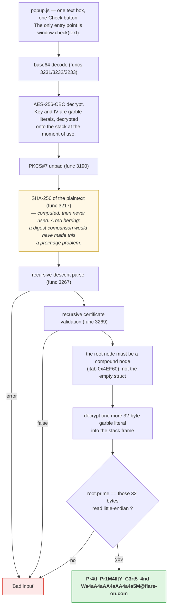
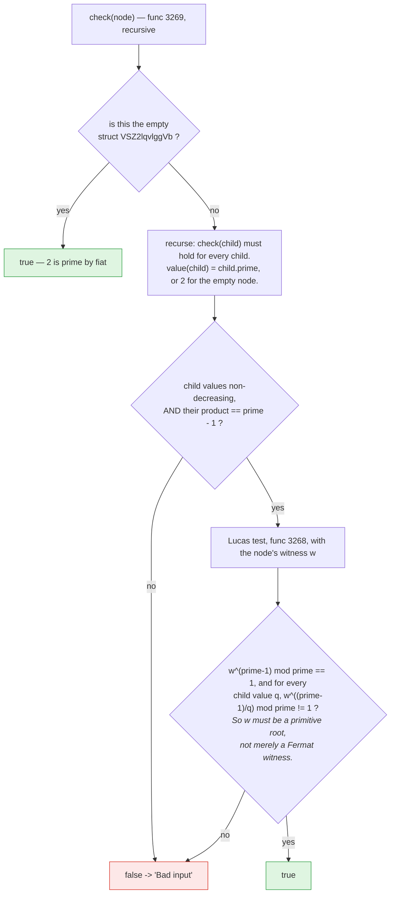

**Archive:** `8-crux.7z` (password `flare`), containing a Chrome MV3 extension · **Flag:** `Pr4tt_Pr1M4lItY_C3rt5_4nd_Wa4aA4aAA4aAA4a4a5M@flare-on.com`

Flare-On is the FLARE team's yearly reverse-engineering contest: each challenge hides a flag, a string
ending in `@flare-on.com`, and you find it by taking the program apart.

This one is a Chrome browser extension with a one-line text box and a **Check** button.


Everything that matters lives in a 5.8 MB `main.wasm`: a Go program compiled to
WebAssembly (a compact bytecode format browsers can run next to JavaScript) and obfuscated with [garble](https://github.com/burrowers/garble),
including `-literals`, so every string and constant in the module is encrypted
and only decrypted onto the stack at the instant it is used.

The extension exposes exactly one entry point, `window.check(text)`. It returns
`"Bad input"` for everything.

What it wants is an **AES-encrypted, serialized [Pratt primality
certificate](https://en.wikipedia.org/wiki/Primality_certificate#Pratt_certificates)**
for one specific 256-bit prime that the module keeps encrypted inside itself.

To produce one you have to recognize the verifier, extract the prime, factor
`P-1` recursively, find a primitive root at every level of the recursion, and
re-serialize the proof in the module's own binary format. There's no shortcut and
nothing to brute-force. You don't extract an answer from this one, you build it,
which is a large part of why I liked it so much.

If the math is unfamiliar: a Pratt certificate is a proof that a number `p` is prime. You exhibit a
number `w` whose powers, taken modulo `p`, run through every value from 1 to `p-1` (a *primitive root*).
Checking that needs the prime factors of `p-1`, and each of those factors carries its own certificate,
so the proofs nest like a tree until they reach the prime 2.

## Tools I used

Mostly a WebAssembly toolkit, the browser's own developer tools, and Python:

| Tool | What I used it for |
|---|---|
| `wabt` (`wasm-objdump`, `wat2wasm`) | the first look: 3,255 functions, no names; later, the call sites in the validator |
| a hand-written **WASM parser and rewriter** (~600 lines of Python) | section parsing, the memory image, and the instrumentation below |
| **Chrome** + a local page + DevTools | running the module, driving `window.check`, reading my own trace |
| `python3` | re-implementing the parser, the validator, the AES layer, and the certificate builder |
| `sympy`-free `python3` (Pollard's rho / Brent, Miller–Rabin) | factoring `P-1`; no CAS needed, it comes apart in under a second |
| `python3 -m http.server` | because a WASM module won't instantiate over `file://` |

**On running it:** the module was never installed as an extension. It was loaded
in a plain local page in a browser tab. Its import list is the stock Go
`wasm_exec.js` set, with no filesystem, no network and no `chrome.*` of any kind,
so inside a tab it is a pure function from bytes to bytes. I'd check that import
list before doing the same with any other WASM module.

## Getting a foothold

`wasm-objdump -x` gives 3,255 functions with no names. garble strips them, and
the Go WASM backend compiles every function into one giant `loop` with a
`br_table` dispatch (a jump table that picks the next block), so even the disassembly fights you: function 3270, the
checker, is 39 KB of bytecode and **18,184 lines** of `wasm-objdump -d` output,
almost all of it dispatch plumbing.

Static reading alone was not going to work. Two pieces of tooling made the rest
tractable, and both are reusable.

### 1. Rewriting the module to trace itself

Go's `wasm_exec.js` import object contains `runtime.clearTimeoutEvent`, a
one-argument import that in practice is essentially never called. Hijacking it
gives a free logging channel **without renumbering any import indices**, which
matters because every call instruction in a 5.8 MB module refers to indices by
number.

A script inserts, at the top of every function body:

```wat
i32.const <funcidx>
call 1                  ;; the hijacked import
global.get 0            ;; Go's stack pointer
i32.const 0x40000000
i32.or
call 1
```

and, inside function 3270 only, right after its dispatch `loop`:

```wat
local.get 0             ;; Go reuses the resume parameter as the block index
i32.const 0x20000000
i32.or
call 1
```

The JavaScript side tags each value by its top nibble, so **one** import yields
three channels: a complete function-call trace, a block-level trace through the
checker's `br_table`, and the stack pointer at every entry. That last one means I
can read the arguments of every call straight out of linear memory, the single flat block of memory a
WASM module works in.

Two things I got wrong on the way there, both worth recording:

- My first attempt at reconstructing the memory image asserted out. I'd forgotten
  to skip the `0x0b` end opcode after each data segment's `i32.const` offset
  expression. One byte.
- My first stack-pointer trace logged **all zeros**. I'd used `local.get 0`,
  which in a Go WASM function is the *resume index* for the goroutine scheduler,
  not the stack pointer. The stack pointer is `global 0`. Half an hour of staring
  at a column of zeros.

### 2. Recovering Go's type metadata

garble renames types, but it keeps the runtime type descriptors. It has to, or
interfaces and reflection would break. Finding the module's `types` base (52,096,
located by finding a pointer type whose `Elem` points back at a type I already
knew) makes `abi.Type.Str` resolvable, and then struct layouts, field names and
interface method sets all come back:

```go
type FPJNbG8y interface{ aMpKVv60(...) }        // the node interface

type VSZ2lqvlggVb struct{}                       // size 0 — this is the prime 2

type MQljbiUyAfc struct {                        // the challenge's bignum
    hpAszrJRyg   bool                            // negative
    mFVADEr7Oo13 []byte                          // magnitude, little-endian
}

type B1698pyli struct {                          // a certificate node
    qY5cSFByu    []FPJNbG8y                      // children
    lSOQ_hx      *MQljbiUyAfc                    // the prime
    zETCbXEQdiyE *MQljbiUyAfc                    // the witness
}
```

The names are garbage, but the **shapes** are not. A 40-byte struct holding
*children plus two bignums*. An empty struct as a second implementation of the
same interface. A recursive validator that calls modular exponentiation.

That is a Pratt certificate and nothing else. The empty struct is the base case,
the prime 2; the two bignums are a prime and a witness. I knew what the input had
to be before I'd read a line of the parser.


<details markdown="1">
<summary>Mermaid source</summary>



</details>

## The crypto layer

AES-256-CBC (the standard AES block cipher in its common chaining mode) with a fixed key and IV, both
garble literals. Rather than reverse
the literal-decryption scheme twice, I lifted them straight out of live memory
after the decryption loop ran.

Which nearly derailed the whole thing, because of byte order.

The key schedule in memory, the per-round keys AES expands from the key, is 480 bytes. Reading the first
32 bytes in raw order gives

```
7ababeca1d8056d1…
```

which is a perfectly plausible-looking key and does not reproduce the plaintext I
was observing. The reason: each schedule word is stored as a little-endian
`uint32` whose **value** is the big-endian reading of four key bytes. The byte
order has to be undone **per word**, not over the whole buffer. Writing each of
the first eight words back out big-endian:

```
key = cabeba7ad156801d1c82381c7cb8a3c406ae2c3cd168a96cd8373684cdbf8723
iv  = 5ff26040c4c20b9f2ffdefa7ecf65d91
```

The plaintext's SHA-256 is also computed, in function 3217, and then never used
for the decision.

I lost time to that, because a digest comparison would have made the challenge a
preimage problem (finding an input that produces a given hash), which is to say unsolvable, so I kept hunting for whatever I
must be misreading. The trace eventually showed the result simply being
discarded.

## The input format

Function 3267 is a recursive-descent parser over the decrypted plaintext. From
its bytecode:

```
node := 0x00                                   -- the prime 2 (VSZ2lqvlggVb{})
      | 0x01 u32(nchildren)
             ( u32(len) <node> ) * nchildren    -- each child length-prefixed
             u32(len) <prime magnitude>         -- little-endian bytes
             u32(len) <witness magnitude>       -- little-endian bytes
```

All `u32` are little-endian. A `0x00` must be the whole of its slice; anything
else is an error. The parser returns `(FPJNbG8y, error)` and the caller bails to
`"Bad input"` on a non-nil error.

## The validator

The validator checks the certificate from the leaves up. The "Lucas test" in it is the step that proves a
node's witness really is a primitive root.


<details markdown="1">
<summary>Mermaid source</summary>



</details>

The supporting functions, named by what the dynamic trace showed them doing
rather than by any symbol:

| func | role |
|------|------|
| 3251 | `newBignum(int)` |
| 3252 | `newBignum(bytes, neg)` |
| 3254 | `Cmp` |
| 3256 | `Add` |
| 3257 | `Sub` |
| 3258 | `Mul` |
| 3261 | `Div` |
| 3262 | `ExpMod` |
| 3268 | the Lucas step |
| 3269 | the recursive certificate check |

### The two functions, from the bytecode

The dispatch plumbing hides the logic, but the call instructions survive it.
Filtering `wasm-objdump -d` down to just the calls in each function, in address
order, gives this:

```text
func[3268]  the Lucas step             func[3269]  the certificate check
0x40eddc  call 1348                    0x40f323  call 1348
0x40ee0d  call 3251   newBignum        0x40f3b3  call 3251   newBignum
0x40ee38  call 3257   Sub              0x40f3ee  call 3251   newBignum
0x40ee86  call 3262   ExpMod           0x40f557  call 3269   itself, per child
0x40eebb  call 3251   newBignum        0x40f631  call 3251   newBignum
0x40eee5  call 3254   Cmp              0x40f688  call 3254   Cmp
0x40efc0  call 3251   newBignum        0x40f6db  call 3258   Mul
0x40efeb  call 3257   Sub              0x40f787  call 3268   Lucas step
0x40f0bc  call 3251   newBignum        0x40f7c5  call 3251   newBignum
0x40f110  call 3261   Div              0x40f7ff  call 3251   newBignum
0x40f163  call 3262   ExpMod           0x40f82a  call 3256   Add
0x40f19d  call 3251   newBignum        0x40f87f  call 3254   Cmp
0x40f1c7  call 3254   Cmp              0x40f926  call 3268   Lucas step
```

The names in the second column are the roles from the table above. `call 1348`
is the same 23-byte helper at the entry of both functions, which I didn't need
to name.

Read top to bottom, 3268 is the Lucas test in the order the diagram gives it:
`p - 1`, then `w^(p-1) mod p` compared against 1, then a second block that
divides `p - 1` by a child's value and raises `w` to that power before comparing
again. 3269 calls itself on the children, compares them pairwise for order,
multiplies them together, and uses `Add` and `Cmp` before the second Lucas call.
That last pairing reads like a check of `product + 1` against the prime rather
than `prime - 1` against the product; either way it is the same test. Each `call`
lives in its own `br_table` block, so this is the order the calls appear in, not
proof of the order they run in. The dynamic trace is what settled that.


### The first input that worked

Before building anything large, I wanted proof I'd read the format right. The
product rule hands you a minimal accepted tree: a compound node with no children
has an **empty product**, which is 1, so it needs `prime - 1 == 1`.

```
01 00000000 00000000  02  00000000
```

A childless node whose prime is 2. I fed it in and the block trace moved out of
the `"Bad input"` block and into the next stage. Thirteen bytes, and they
confirmed the container format, the field order, the endianness, the parser and
the validator all at once.

I'd reach for that sooner next time. I was well into planning the full
certificate builder before it occurred to me to go looking for the smallest input
the machine would accept.

## The target prime

Past the validator, the checker decrypts one more 32-byte literal with garble's
swap-and-subtract scheme and compares the root node's prime against it. Dumping
the stack frame after the 16-iteration decryption loop gives:

```
61e230c979e1be78551b7c44963c5a65e3e827b3b04a7adacc029a37bbdf89d3
```

Read big-endian, that number is **composite**.

Which is impossible. The whole program is a primality certificate verifier, so
the thing it certifies has to be prime. Either my dump was wrong, my factoring
was wrong, or the challenge was broken.

None of the above: it's a byte-order bug, mine, and the same one as the AES key.
Read little-endian, which is the order the challenge's own bignum type uses for
its magnitude, and it's a 255-bit prime:

```
P = 95681613235744740119807961018865688051340183696570761153419351987106658443873
```

A value that fails a test it cannot possibly fail is a byte-order bug, not a
dead end. I now treat "this is mathematically impossible" as a strong signal
that I'm reading bytes in the wrong direction, rather than as a result.

And:

```
P - 1 = 2^5 * 1777 * 117013415621
        * 14379885447462257985539844615548173977763374139182362877999463
```

That 203-bit cofactor is itself prime, so **no hard factoring is needed anywhere
in the tree**. The author picked `P` so the whole recursive factorization is
easy, which is exactly right for a challenge. The work is in understanding the
structure, not in burning CPU. Pollard's rho, a standard factoring method that is fast when the factors are small, finishes in under a
second and the certificate comes out at 357 nodes.

## Building the answer

`solve8.py` factors `P-1`, builds the certificate (choosing the smallest
primitive root at each level), verifies it against my re-implementation of the
WASM validator, serializes it to 3,891 bytes, and encrypts it:

```
sha256(plaintext) = c9c3e3392c54fa79b313b8f9696539b8838740cafe086e036ba888ac1e358086
blob = 5208 base64 characters
```

Paste that into the popup, press **Check**, and wait about ten seconds. The
bignum library uses **byte** limbs and the proof needs a few hundred 256-bit
modular exponentiations, so it's slow in a way that feels broken the first time:


The full solver is in the [flare-on-13 repository](https://github.com/taogoldi/flare-on-13): [`solve8.py`](https://github.com/taogoldi/flare-on-13/blob/main/solvers/solve8.py).

## Four details that caught me out

**Repeated factors are repeated children.** `P-1` has `2^5`, so the root needs
**five** `0x00` children before its three larger ones. The validator multiplies
child values and compares to `prime - 1`; it does not collect exponents.

**Children must be in non-decreasing order** of their certified prime. Sorting
the factor list is enough, and the empty node (2) is naturally smallest. This is
checked, and it fails silently as `"Bad input"` like everything else.

**The witness must be a primitive root**, not merely a Fermat witness. The test
demands `w^((p-1)/q) != 1` for *every* prime `q` dividing `p-1`, which is the
definition. I found this the easy way, by reading the validator, but a
certificate built with a random Fermat witness would fail at some arbitrary depth
with no indication why.

**A malformed child kills the instance.** Feeding the module bad input at the
wrong place made the Go program call `os.Exit(2)` with no message, after which
every subsequent call returns nothing. My probe harness re-instantiates the
module between attempts rather than reloading the page, which also makes the
whole thing scriptable.

## Why this one stuck with me

Most reversing challenges end with you extracting something. This one ends with
you building something: to a specification you had to recover from obfuscated
bytecode, in a format you had to infer, for a number you had to find encrypted
inside the program.

And the mathematics isn't decoration. A Pratt certificate is a recursive proof of
primality, linear to verify and, for a well-chosen prime, cheap to construct.
I had not expected to spend an evening writing one because a 5.8 MB obfuscated
Go module wouldn't accept anything else.

**Flag:** `Pr4tt_Pr1M4lItY_C3rt5_4nd_Wa4aA4aAA4aAA4a4a5M@flare-on.com`
