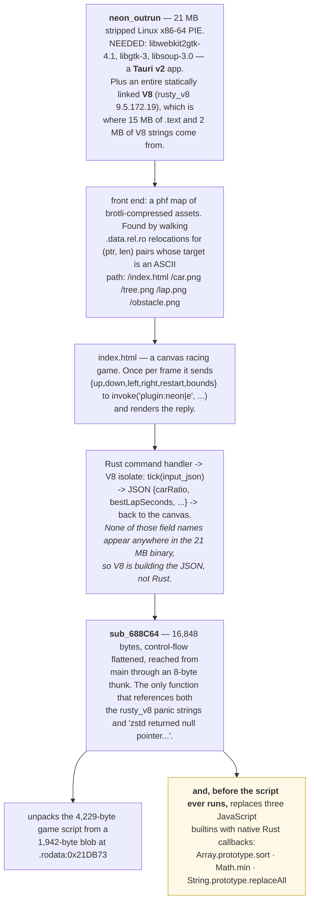
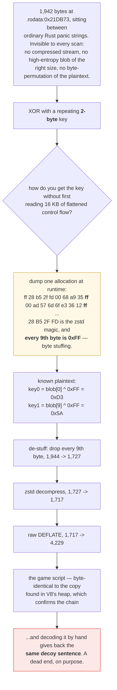
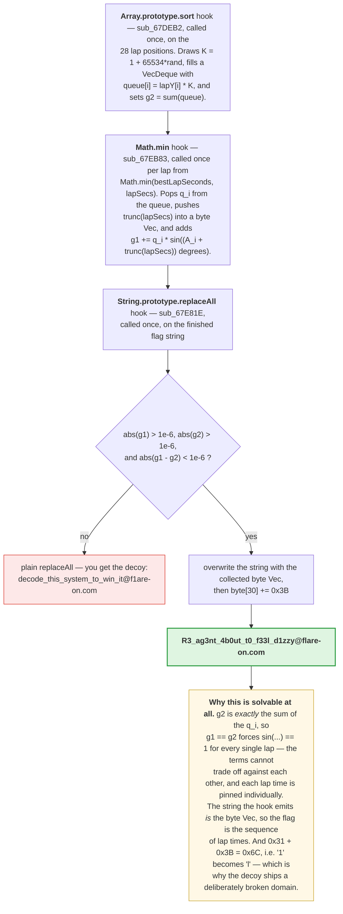

**Archive:** `9-NeonOutRun.7z` (password `flare`), containing `neon_outrun` · **Flag:** `R3_ag3nt_4b0ut_t0_f33l_d1zzy@flare-on.com`

I submitted the wrong flag for this one. That's going at the top rather than the
bottom, because it's the most useful thing in the write-up.

(Flare-On is the FLARE team's yearly reverse-engineering contest: each challenge hides a flag, a string
ending in `@flare-on.com`, and you find it by taking the program apart. This was the last challenge of the
set.)

`neon_outrun` is a 21 MB Linux x86-64 program, stripped of its function names and built as a PIE
(position-independent executable, loadable at any address). It's a **Tauri v2** desktop app, a framework
whose interface is a web page shown in an embedded browser (`NEEDED` lists `libwebkit2gtk-4.1`, `libgtk-3` and `libsoup-3.0`) whose front
end is a top-down racing game. On top of that it statically links **an entire
V8**, Google's JavaScript engine, (the `rusty_v8` crate, V8 9.5.172.19), which is where 15 MB of `.text` and
a 2 MB pile of V8 strings come from.


It has three layers, and the first two are traps:

1. Win the 28 laps and it prints a flag. **It is fake.**
2. That fake flag reads *"decode this system to win it"*. Decoding the packer
   that hides the game's JavaScript gets you **exactly the same fake flag back**.
3. The real flag is in neither. Before running the script, the Rust side
   **replaces three JavaScript builtins with native code**, and the flag is the
   sequence of lap times those hooks are waiting for.

## Tools I used

Binary tools for the Linux executable, a container to run it in safely, and a lot of memory reading:

| Tool | What I used it for |
|---|---|
| `readelf` / `objdump` / a hand-written **ELF helper** | sections, `R_X86_64_RELATIVE` relocations, `.eh_frame_hdr` to recover function boundaries in a stripped PIE |
| `capstone` | disassembly, and a cached index of every RIP-relative `lea` target → call sites |
| `radare2` + `r2ghidra` | the packer loop listing and pseudocode for the `sort` and `replaceAll` hooks |
| **Docker** (`--platform linux/amd64`, `--network none`) + **Xvfb** | running a Linux GUI binary safely on an Apple-silicon Mac |
| a custom **`LD_PRELOAD` shim** on `malloc`/`free`/`realloc` with `backtrace()` | because `gdb` cannot `ptrace` under that emulation |
| `/proc/<pid>/mem` + a Python sampler | reading V8's heap and the implant's globals out of a live process |
| `brotli`, `zstandard`, `zlib` | the asset map and the four-stage packer |
| **Unicorn** | emulating self-contained x86-64 functions rather than reading flattened control flow |
| `python3` | `solve9.py`, which does the whole static half from the binary alone |

**On running it:** `neon_outrun` is a Linux GUI binary, so it ran inside a
`linux/amd64` container with `--network none`, an Xvfb display, and the challenge
mounted read-only. Never on the host. Its strace showed no file access outside
`/usr`. Everything I executed was either the stock binary or a copy with its own
embedded assets replaced.

## Layer 1: the game

Tauri embeds the front end as a `phf` map (a lookup table built at compile time) of brotli-compressed
files. You don't have to understand `phf` to get at them: walk the relocations in `.data.rel.ro` (the
table of addresses the loader fixes up at startup) looking for `(ptr, len)` pairs whose target is an ASCII path, and the whole asset table
falls out at once.

```
/index.html   /car.png   /tree.png   /lap.png   /obstacle.png
```


`index.html` sends `{up,down,left,right,restart,bounds}` to
`invoke('plugin:neon|e', …)` once per frame and renders the reply. And here's
the observation that sets up the whole challenge: **none of the reply's field
names** (`carRatio`, `bestLapSeconds`, the rest) **exist anywhere in the
21 MB binary.** Not as literals, not in any section. So the JSON is not built by
Rust. V8 builds it, from a script that isn't in the file either.

Running the binary under Xvfb in a container and scanning `/proc/<pid>/mem`
finds the 4,229-byte script in V8's heap about 0.2 s after launch. It spells a
flag one character per lap over 28 laps:

```js
neon += messages[Math.floor((state.currentLap-1)/2)][map[state.currentLap-1]];
…
neon += String.fromCharCode(64,102,49,97,114,101,45,111,110,46,99,111,109);
state.neon = neon.replaceAll(" ","_");
```

Actually winning 28 laps of a racing game by hand was not how I wanted to spend
an evening, so I patched the embedded `index.html` with an auto-driver. The
cheapest possible cheat: `bounds` of `{left:0, right:1e9}` makes the road a
billion units wide, so every obstacle is thousands of units off the center line,
and holding *accelerate* wins every time.

The game duly printed:


### Where I went wrong

Look at that last `String.fromCharCode`: `64,102,49,97,114,101,45,111,110,46,99,111,109` is `@f1are-on.com`. A digit **`1`**, not an `l`.

I saw it. I decided it was a typo in the challenge, "corrected" it to
`@flare-on.com`, and submitted `decode_this_system_to_win_it@flare-on.com`.

Rejected, obviously.

The string was telling me, in English. *"Decode this system to win it."* That's
an instruction, not a flag. Flare-On flags are usually a sly comment on the
solution; this one was a sly comment on the fact that I hadn't found it yet.

A program handing you something flag-shaped has not told you it's the flag. An
artifact that *almost* fits the expected format is evidence against it, and the
right move is to go find out why it doesn't fit.

The giveaway was sitting there: nothing in the binary explained why that domain
would be stored broken in the first place. "Something later repairs this" was a
hypothesis I could have tested in ten minutes. It's a hook that adds `0x3B` to
byte 30 once a real check passes. `0x31 + 0x3B = 0x6C`. `'1'` becomes `'l'`.

Second time in this set I'd talked myself past a wrong domain, too. Challenge 4's
decoy was `@flare.com`. I caught that one.


<details markdown="1">
<summary>Mermaid source</summary>



</details>

## Layer 2: the packer

So where does the script live? I threw everything at the file and found nothing.

Not as text. Not brotli'd, deflated, LZMA'd or zstd'd; I scanned for every
container magic and tried every window offset. Not a byte-permutation of itself
either, which I checked by frequency signature. And not in any of the three
zlib-compressed blobs at the end of `.rodata`, which turned out to be V8's own
startup snapshots (`0xC0DE041B` once inflated) and ate a chunk of my evening on
their own.

Content-based search was never going to find this. The stored
form is **XORed and byte-stuffed before it is compressed**, so it looks like
neither plaintext nor a compressed stream. There is no signature to scan for.

What cracked it was going at the *loader* instead. Exactly one function
references both the `rusty_v8` panic strings and the string `"zstd returned null
pointer when creating new context"`: `sub_688C64`, 16,848 bytes, reached from
`main` through an 8-byte thunk. It's control-flow flattened (an obfuscation that turns a function into one big loop around a switch, so
the real order of its steps is hidden) and unpleasant, but one loop in the middle is in the clear:

```asm
lea   rcx, [rip - 0x46c2b2]              ; -> .rodata:0x21DB73
loop: mov  edx, eax
      and  edx, 1
      mov  dl,  byte [rsp + rdx + 0x7e]  ; a 2-byte key, built by the flattened code
      xor  dl,  byte [rax + rcx]
      mov  byte [r15 + rsi], dl
      inc  rsi
      inc  rax
      cmp  rax, 0x796                    ; 1942 bytes
      jne  loop
```

A repeating two-byte XOR over 1,942 bytes at `.rodata:0x21DB73`, sitting
innocuously between ordinary Rust panic strings. I now had the location but not
the key, and the key is assembled somewhere in those 16 KB of dispatch.

### `gdb` doesn't work here

My first instinct was to breakpoint after the loop and read the buffer. That
doesn't work: **`gdb` cannot `PTRACE_GETREGS` an amd64 process under Docker's
emulation on Apple silicon.** The process runs; the debugger cannot see its
registers.

So I wrote an `LD_PRELOAD` shim over `malloc`/`free`/`realloc`: a small library the Linux loader puts
ahead of everything else, so its versions of those functions run instead of the real ones. It remembers
every 1,942-byte allocation and dumps it a few allocations later (you can't dump
it immediately, since at the moment of allocation it's still uninitialized).

Two bugs on the way, both the kind that only bite inside an allocator hook:

- It segfaulted instantly, because my `init()` used stdio, and `fopen` calls
  `malloc`, which calls my hook, which calls `init()`. Fixed by using raw
  `open`/`write` and resolving everything with `dlsym` in a constructor.
- `__builtin_return_address(n)` for `n > 0` crashed in optimized Rust frames
  with no frame pointer. Only `__builtin_return_address(0)` is safe.

(And then the ring buffer wrapped before my sweep could run, so I switched to
checking the slot inserted N entries ago, which is O(1) per `malloc`.)

The dump begins:

```
ff 28 b5 2f fd 00 68 a9 35  ff 00 ad 57 6d 6f e3 36 12  ff fe 2b ac 3f ec 4a …
```

`28 B5 2F FD` is the zstd magic. And **every 9th byte is `0xFF`**.

That is byte stuffing, a fixed byte inserted at fixed intervals. Because I knew what those bytes had to be
before the XOR, they are a known plaintext, and the key falls out immediately:

```
key0 = blob[0] ^ 0xFF = 0xD3
key1 = blob[9] ^ 0xFF = 0x5A
```

Better still, it's a **file-wide signature**. `solve9.py` finds the blob without
knowing the offset by scanning for "XOR with a 2-byte key such that every 9th
byte is `0xFF`," and it finds **exactly one**, which also proves there is no
second payload hiding anywhere.

So when content-based search fails, look for a known-plaintext structure in the
container rather than in the payload. I was searching for the shape of the
*data*. The thing that was findable was the shape of the *wrapper*.


<details markdown="1">
<summary>Mermaid source</summary>



</details>

The unpacked script is byte-identical to the copy V8 had in its heap, which
confirmed the chain end to end. And decoding it by hand gives back exactly the
same decoy sentence I already had.

A dead end, on purpose, with the fake flag telling you to walk down it.

## Layer 3: the hooks

`sub_688C64` builds its strings the way the `obfstr` Rust crate does: two heap buffers filled
from immediates and XORed together. You don't have to follow the control flow at
all: extract every such pair statically and the function's whole vocabulary falls
out.

```
"String"   "prototype"   "replaceAll"   "Math"   "min"   "Array"   "sort"   "tick"
```

That list is the whole answer in eight words. Three builtins are replaced with
native callbacks **before `tick` ever runs**:

| builtin | callback | what it really does |
|---------|----------|---------------------|
| `Array.prototype.sort` | `sub_67DEB2` | called once, on the 28 lap positions |
| `Math.min` | `sub_67EB83` | called once per lap, from `Math.min(bestLapSeconds, lapSecs)` |
| `String.prototype.replaceAll` | `sub_67E81E` | called once, on the finished flag string |

This is a nasty place to hide logic. The JavaScript is clean; it calls
`sort`, `Math.min` and `replaceAll` exactly where you'd expect a game to. The
semantics are somewhere else entirely. You can read the whole script and learn
nothing, which is exactly what happened to me in layer 2.


<details markdown="1">
<summary>Mermaid source</summary>



</details>

The `replaceAll` hook is the one place where the whole check is readable
without measuring anything. The Ghidra decompiler plugin in `radare2` gives this
for `sub_67E81E`, trimmed to the check and the rewrite:

```c
    func_0x00604a82(&cStack_c0, 0x1438590);           /* read g1 */
    fStack_88 = *(iStack_b8 + 8);
    ...
    func_0x00604a82(&cStack_c0, 0x1438580);           /* read g2 */
    fStack_98 = *(iStack_b8 + 8);
    ...
    if (((*0x107e28 < (fStack_88 & *0x105460)) &&     /* |g1| > 1e-6 */
         (*0x107e28 < (fStack_98 & *0x105460))) &&    /* |g2| > 1e-6 */
        ((fStack_88 - fStack_98 & *0x105460) < *0x107e28)) {   /* |g1 - g2| < 1e-6 */
        ...
        for (uVar11 = 0; uStack_50 != uVar11; uVar11 = uVar11 + 1) {
            if (uVar11 < uVar8) {
                pcStack_d0[uVar11] = *(iStack_58 + uVar11);    /* copy the lap-time bytes over the string */
            }
        }
        ...
        if (0x1e < uStack_c8) {
            pcStack_d0[0x1e] = pcStack_d0[0x1e] + ';';         /* byte[30] += 0x3B */
        }
```

The two constants come straight out of `.rodata`. `0x107e28` holds
`0x3eb0c6f7a0b5ed8d`, which is the double `1e-6`, and `0x105460` holds
`0x7fffffffffffffff`, the mask that clears the sign bit, so `x & mask` is
`fabs(x)`. The globals it reads are the `g1` and `g2` I sampled later. And the
`';'` is `0x3B`, written as a character constant because the decompiler typed
the byte as `char`.

Around the check, the function is control-flow flattened: the copy and the
`+ ';'` sit inside a `do { ... } while (true)` that dispatches on a 32-bit state
XORed with a new constant each pass. The `Math.min` hook is the same pattern
with no readable body at all, and its decompilation jumps straight into
`0x67F9D8`, the first of the two functions I measured instead of read.

One more thing the decompiler showed me in the `sort` hook: the random scale
`K` comes from a 64-bit LCG (linear congruential generator, multiply-and-add) with multiplier `0x5851f42d4c957f2d` and increment
`0x14057b7ef767814f`. Each draw adds the current time in nanoseconds (or 42, if
reading the clock fails) to a thread-local state that starts at
`0x123456789abcdef0`, then steps the LCG. Those are the same PCG constants as the keystream in challenge
6. It doesn't matter here, because `K` cancels out of `g1 == g2`.


Three things fall out of that.

`g2` is *exactly* the sum of the `q_i`, so `g1 == g2` forces `sin(...) == 1` for
every single lap. The terms can't trade off against each other, which means each
lap time is pinned on its own. That's the difference between this and a
28-dimensional search.

The string the hook emits *is* the collected byte vector, so the flag is the
sequence of lap times.

And `byte[30] += 0x3B` turns the decoy's `'1'` (0x31) into `'l'` (0x6C). That's
the explanation for the broken domain, sitting right where I should have gone
looking for it.

## Measuring instead of reading

`A_i`, the per-lap phase offset, comes out of two more control-flow-flattened
functions, `sub_67F9D8` and `sub_68003E`: 32 KB of dispatch-on-constant with
`bswap` and `0x0f0f…`/`0x3333…`/`0x5555…` bit twiddling. I did not want to read
them, so I measured them instead.

Because the packer is now fully understood, it can be run **forward**. I
compressed a probe script with the same four-stage chain, patched it over the
blob, fixed the three `0x796` length immediates at `0x689DE6`, `0x689E07` and
`0x689E3B`, and replaced `index.html` with a driver.

Those immediates have a gotcha of their own: `cmp rax, 0x796` assembles as `48 3D
imm32`, so the immediate sits at offset **2**, not 3. I patched the wrong byte
first, and the resulting crash took longer to attribute than it should have.

The probe exposes a tiny command interface:

```js
{"c":"i"}            // build 28 lap values and sort() them  -> arms the hooks
{"c":"m","v":b}      // Math.min(1e9, b)                     -> exactly one hook call
{"c":"r"}            // "…41 chars…".replaceAll(" ","_")     -> test the check
```

while a sampler reads `g1`, `g2` and the queue out of `/proc/<pid>/mem` at
`.data:0x1438590`, `.data:0x1438580` and `.data:0x1428500`.

Dividing each `g1` step by its `q_i` gives the sine directly, and four probe
rounds (`b = 0,1,2,3`) show it is exactly `sin((A_i + b)°)`:

```
lap  0 : 0.139173  0.156434  0.173648  0.190809   = sin  8°,  9°, 10°, 11°
lap 11 : 0.669131  0.681998  0.694658  0.707107   = sin 42°, 43°, 44°, 45°
```

Whole degrees, cleanly. So `A_i = asin(s_i)` and the required lap time is simply
`b_i = 90 - A_i`:

```
 8 39 -5 -7 -13 39 -20 -26 -5 38 -8 42 -27 -26 -5 -26 42 -5 -12 39 39 -18 -5 -10 41 -32 -32 -31
82 51 95 97 103 51 110 116 95 52 98 48 117 116 95 116 48 95 102 51 51 108 95 100 49 122 122 121
 R  3  _  a   g  3   n   t  _  4  b  0   u   t  _   t  0  _   f  3  3   l  _   d  1   z   z   y
```

(Yes, the first row contains negative numbers. The hook takes `trunc(lapSecs)`
and never checks the sign, which is how a "lap time" can be `-26`.)

Feeding those 28 bytes back through the real `Math.min` hook makes the real
`replaceAll` hook print it itself:

```
R3_ag3nt_4b0ut_t0_f33l_d1zzy@flare-on.com
```

*"RE agent about to feel dizzy."* Which, after three layers and a wrong
submission, felt earned.

For what it's worth: driving this by hand would need `sum(flag bytes)` = **2,531
seconds** of lap times. About 42 minutes of holding an arrow key to exactly the
right second, 28 times in a row, with negative values somewhere in there. The
intended solution is definitely not to play the game.

## Odds and ends

- `tree.png` is a 1185×1280 **WebP** with a 143 KB `ALPH` chunk, despite the
  `.png` name. That screams steganography and isn't. The alpha is a lossy tree
  silhouette, and the `infer` crate (which drags in `cfb`, which looks like OLE
  parsing, which looks like a clue) is just Tauri's MIME sniffing. I did not
  work that out quickly.
- The three high-entropy blobs at the end of `.rodata` are V8's own
  zlib-compressed startup snapshots (`0xC0DE041B` once inflated), not challenge
  data.
- The decoy is well built. Searching a memory dump for `flare-on` finds
  **nothing**, because the domain is assembled from character codes *and* left
  broken until the real check passes. Both halves of that are necessary and both
  are deliberate.

## `solve9.py`

Takes `neon_outrun` and prints both flags. Stage 1 is fully static: it finds the
packed script by signature rather than by offset, recovers the XOR key from the
stuffing bytes, runs the de-stuff → zstd → inflate chain, and decodes the decoy
sentence. Stage 2 turns the hook measurements in `neon_oracle_trace.json` into
the real flag. It needs `zstandard` (or the `zstd` CLI) and nothing else.

The full solver is in the [flare-on-13 repository](https://github.com/taogoldi/flare-on-13): [`solve9.py`](https://github.com/taogoldi/flare-on-13/blob/main/solvers/solve9.py).

**Flag:** `R3_ag3nt_4b0ut_t0_f33l_d1zzy@flare-on.com`
